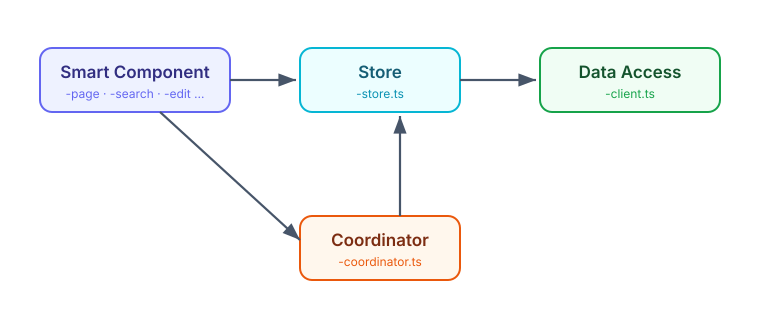
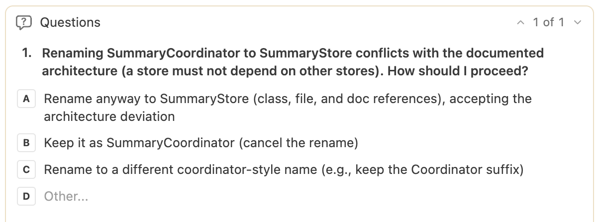
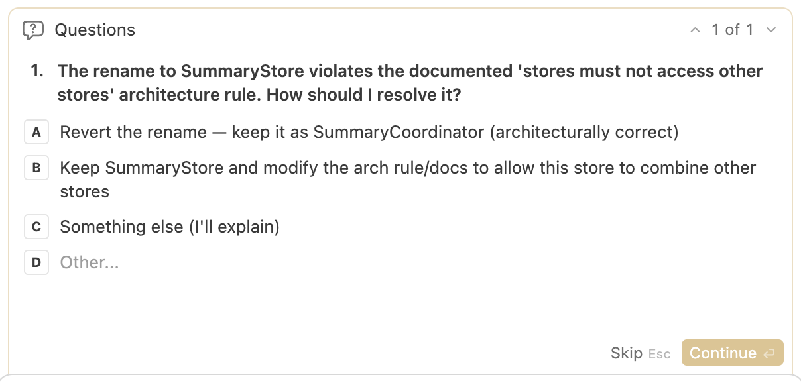
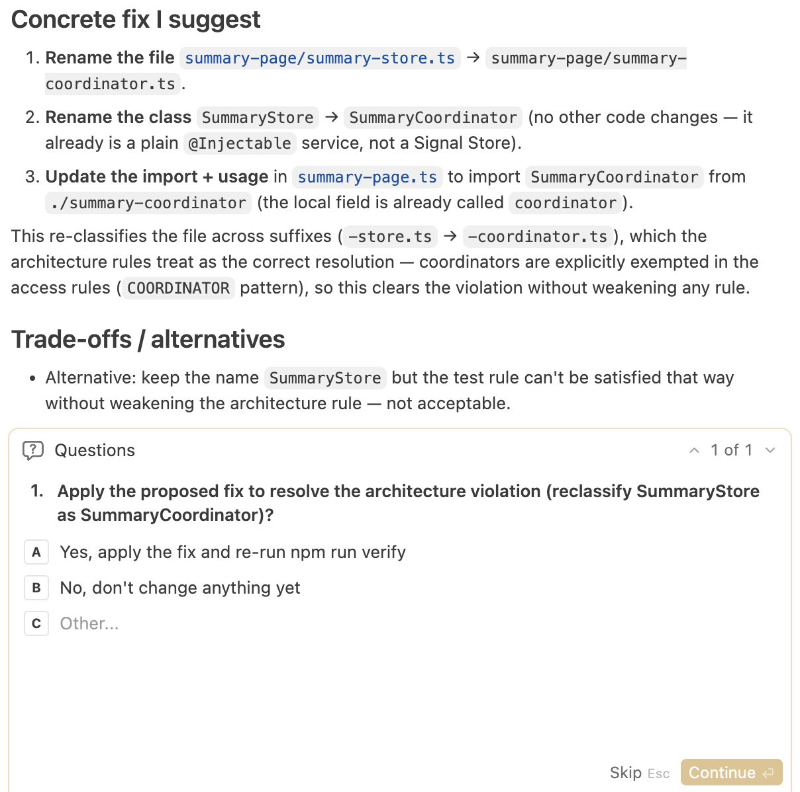

# Architecture Beyond Layers: tsarch for AI Coding Agents

*June 8, 2026 | Article by Manfred Steyer*

Source : <https://www.angulararchitects.io/en/blog/architecture-beyond-layers-tsarch-for-ai-agents/>


This is post 2 of 2 in the series *“AI-assisted Angular Architecture”*

1.  [AI-Assisted Coding: Architecture as an Executable Contract](https://www.angulararchitects.io/en/blog/reliable-angular-architectures-with-ai-assisted-coding/)
2.  Architecture Beyond Layers: tsarch for AI Coding Agents

In the first part of this series we built the big guardrail: architecture rules get documented, brought into the coding agent's context through Rules and Skills, checked with Sheriff, and fed back as deterministic feedback via Stop hooks.

That closes the feedback loop for domain and layer boundaries. With Feature Slicing, however, additional rules arise *within* a feature – for example between Smart and Dumb Components, Stores, and services for data access.

This is exactly where this second part comes in. We extend the setup with **tsarch**, a tool for TypeScript projects inspired by the well-known **ArchUnit** library. With it, naming and access conventions become executable architecture rules – checked as a unit test and wired into the same agent feedback loop that already carried Sheriff in the first part.

*Where layers reach their limits, naming conventions take over: tsarch checks them deterministically and turns an architecture violation into machine feedback that the coding agent picks up.*

📂 [Source Code](https://github.com/angular-architects/flights42/tree/ai-arc) (Branch: `ai-arc`)

## Architecture Rules via Building Blocks in Addition to Layers

In the first part we used Sheriff to channel the communication between modules: domains represent functional boundaries, layers technical ones. However, not all technical constraints can be expressed well through layers – especially not when, with Feature Slicing, we allow a feature to have its own Dumb Components, data access services, and Stores. These building blocks then sit together in the feature folder rather than separated into their own layers.

That is why we additionally constrain things by **Building Blocks** here. What matters is no longer just which layer a building block sits in, but what *kind* of building block it is – and which building blocks may access which:



The central rule for our example project is: a **Smart Component** accesses a **Store**, and only the Store accesses the **Data Access client**. Smart Components therefore must not access the client directly, and Stores must not access other Stores.

Especially when using lightweight Stores, you often need a **Coordinator** that stores no data itself but, for a use case, provides the states from different Stores – possibly from different layers – and ties them together via `computed` signals. This use-case orchestration is handled by the Coordinator, which from the component's point of view looks like a "real" Store. This way we avoid Store-to-Store dependencies, and thus cycles, without giving up the convenience of a bundled view across multiple Stores.

There is one deliberate exception for **Dumb Components**: they only get access to Stores in the same folder or in child folders. In this case we assume local state management that is a pure implementation detail of the Dumb Component. Apart from that, Dumb Components must not access any of the other building blocks described here.

## Recognizing Building Blocks via File Suffixes

We recognize the individual building blocks by their file suffixes. This fits well with the current conventions of the Angular team, implemented by the CLI: components, services, and directives no longer get default suffixes. Not because suffixes are bad, but because generic suffixes like `Component` or `Service` offer too little value. The Angular team explicitly emphasized, however, that you can assign your own, semantically stronger suffixes – and that is exactly what we use here.

In our demo project I decided on the following suffixes:

- **Smart Components** carry a descriptive use-case suffix: `-page`, `-search`, `-edit`, `-detail`, or `-overview` – for example `flight-search.ts` with the class `FlightSearch` or `luggage-overview.ts` with `LuggageOverview`.
- **Stores** end in `-store.ts` – for example `flight-search-store.ts` with `FlightSearchStore` or `passenger-detail-store.ts` with `PassengerDetailStore`.
- **Coordinators** of Stores end in `-coordinator.ts` – for example `summary-coordinator.ts` with `SummaryCoordinator`.
- **Data access** (clients) ends in `-client.ts` – for example `flight-client.ts` with `FlightClient` or `airport-client.ts` with `AirportClient`.
- **Dumb Components** are recognized by the suffixes `-card` and `-pane`, or by the fact that they live in a `ui` folder – for example `flight-card.ts`.

The authoritative, executable definition of these conventions lives in the tsarch unit test itself, which we will look at more closely in a moment. There the suffixes appear as regular expressions and are thus unambiguous – both for humans and for coding agents.

## Setting Up tsarch

tsarch parses the TypeScript project via the Compiler API and lets you check dependencies between files in readable, fluently phrased rules. We install the npm package as a dev dependency:

```bash
npm install -D tsarch
```

For tsarch to know which files belong to the project, it needs a `tsconfig`. Since tsarch reads it directly and does not resolve `extends`, we *unfortunately* have to provide a small dedicated `tsconfig.arch.json` that contains exactly what tsarch needs: the relevant compiler options (such as `target`, `module`, `moduleResolution`, and `experimentalDecorators` for Angular's decorators) as well as literally specified `include` and `exclude` paths:

```json
{
  "compilerOptions": {
    "target": "ES2022",
    "module": "esnext",
    "moduleResolution": "bundler",
    "experimentalDecorators": true,
  },
  "include": ["src/**/*.ts"],
  "exclude": ["src/**/*.spec.ts", "src/app/testing/**", "node_modules"]
}
```

This duplication of the `tsconfig` is admittedly not pretty – I hope that a future PR to tsarch will add support for resolving `extends`. Until then, the small dedicated file is a manageable price.

The architecture rules themselves are perfectly ordinary tests. They do not run in the browser-based `ng test` environment, though, but with Vitest in a Node environment, because tsarch analyzes the TypeScript project via the compiler and the file system. The configuration for this is straightforward:

```ts
import { defineConfig } from 'vitest/config';

export default defineConfig({
  test: {
    globals: true,
    environment: 'node',
    include: ['arch/**/*.spec.ts'],
    testTimeout: 60_000,
    hookTimeout: 60_000,
  },
});
```

Finally, we add a script to `package.json` that starts these architecture tests:

```json
"test:arch": "vitest run --config vitest.arch.config.ts"
```

With that, the scaffolding is in place. The actual rules live in `arch/access-rules.spec.ts` and rely on a few helper functions from `arch/utils.ts`. We will look at both, rule by rule, in the following sections.

## Restricting Access to Data Access

In our architecture, only Stores – and the `ai` layer – may access data access services or clients. All other building blocks, in particular Smart and Dumb Components, must take the detour through a Store. We deliberately exempt the `ai` layer because, in concert with an agent, it handles the orchestration of the application at runtime.

The following snippet shows the head of the spec file with the suffix constants and the first rule. The further `it` blocks are replaced by an ellipsis and follow in the next sections:

```ts
import { filesOfProject } from 'tsarch';
import { describe, expect, it } from 'vitest';

import {
  anyFileExcept,
  formatDependency,
  isLocalAccess,
  toDependency,
} from './utils';

const TS_CONFIG = 'tsconfig.arch.json';

const STORE = String.raw`-store\.ts$`;
const CLIENT = String.raw`-client\.ts$`;
const SMART = String.raw`-(page|search|edit|detail|overview)\.ts$`;
const DUMB = String.raw`(-(card|pane)\.ts$|/ui(-[^/]+)?/)`;
const AI_LAYER = String.raw`/ai/`;
const COORDINATOR = String.raw`-coordinator\.ts$`;

describe('architecture: suffix-based access rules', () => {
  it('only stores may access data access (clients)', async () => {
    const rule = filesOfProject(TS_CONFIG)
      .matchingPattern(anyFileExcept(STORE, AI_LAYER))
      .shouldNot()
      .dependOnFiles()
      .matchingPattern(CLIENT);

    const violations = await rule.check();
    expect(violations.map(toDependency).map(formatDependency)).toEqual([]);
  });

  // …
});
```

We define the suffixes as regular expressions, using `String.raw` for them. This template tag returns the string without interpreting escape sequences like `\.` – so a `\` stays a real backslash and does not turn into a line break or similar. This saves us the double escaping (`\\.` instead of `\.`) and keeps the regular expressions easy to read.

The rule reads almost like a sentence: take all files of the project that are **neither a Store nor part of the `ai` layer** (`anyFileExcept(STORE, AI_LAYER)`), and make sure they do **not** depend on files ending in `-client.ts`. `rule.check()` returns a list of the violations; if there are none, the expected list is empty and the test is green. If the rule triggers, thanks to `formatDependency` we see directly which file illegally accesses which client.

The helper functions from `utils.ts` used in the first `it` make the rule readable. `anyFileExcept` builds a pattern from the passed suffixes that selects exactly those files that are **none** of the named kinds. Technically, each kind becomes a negative lookahead (`(?!...)`, meaning "must not occur"):

```ts
export function anyFileExcept(...kinds: string[]): string {
  return String.raw`^${kinds.map((kind) => `(?!.*${kind})`).join('')}.*\.ts$`;
}
```

`anyFileExcept(STORE, AI_LAYER)` thus produces a pattern that matches every `.ts` file that is neither a Store nor located in the `ai` layer. This is how we express "everything except …" declaratively, without enumerating every permitted case one by one.

A concrete example makes this tangible: `anyFileExcept(STORE, AI_LAYER)` puts a negative lookahead in front of the actual pattern for each passed positive pattern and thus produces

```text
^(?!.*-store\.ts$)(?!.*/ai/).*\.ts$
```

Read aloud, this means: match every path that ends in `.ts`, **provided** it contains neither `-store.ts` at the end nor `/ai/` anywhere. A file like `flight-search.ts` therefore matches, while `flight-search-store.ts` and everything under `/ai/` drop out.

`toDependency` and `formatDependency` prepare the matches for nicely readable output. `toDependency` extracts the source and target file from a tsarch violation, and `formatDependency` formats them as `source -> target`:

```ts
export function toDependency(violation: unknown): Dependency {
  const { dependency } = violation as {
    dependency: { sourceLabel: string; targetLabel: string };
  };
  return { source: dependency.sourceLabel, target: dependency.targetLabel };
}

export function formatDependency(dependency: Dependency): string {
  return `${dependency.source} -> ${dependency.target}`;
}
```

This precise output is decisive later on: it is not only feedback for developers, but also a deterministic signal with which the coding agent can fix a violation in a targeted way.

### Modern Angular

You can find more about Signal Forms and modern Angular architecture in my new eBook Modern Angular. It covers Signals, architecture, testing, AI assistants, and practical solutions for modern business applications.

[](https://www.angulararchitects.io/modern-book)

[More about the book →](https://www.angulararchitects.io/modern-book)

## Restricting Access to Stores

Only Smart Components – and again the `ai` layer – get access to Stores. There is, however, the exception already mentioned: Dumb Components may access Stores in the same folder or in child folders. In this case we assume local state management that is an implementation detail of the Dumb Component. We also exempt Coordinators, since their very job is to combine several Stores.

The corresponding `it` implements this mix of general rule and local exception:

```ts
it('only smart components may access a store (locality and ai excepted)', async () => {
  // Coordinators are a dedicated service layer that may combine several stores.
  const rule = filesOfProject(TS_CONFIG)
    .matchingPattern(anyFileExcept(SMART, AI_LAYER, STORE, COORDINATOR))
    .shouldNot()
    .dependOnFiles()
    .matchingPattern(STORE);

  // Exception: when the store is co-located (same or child folder)
  const violations = (await rule.check())
    .map(toDependency)
    .filter(({ source, target }) => !isLocalAccess(source, target));

  expect(violations.map(formatDependency)).toEqual([]);
});
```

The base rule selects all files except Smart Components, the `ai` layer, Stores, and Coordinators, and forbids them access to Stores. The local exception cannot be expressed through a pattern alone – it depends on the relative position of two files. That is why we filter the found violations afterwards and let through all those where the Store is local to the accessing file.

This check is handled by the helper function `isLocalAccess`. It returns `true` when the target file sits in the same folder as the source or in a child folder of it:

```ts
export function isLocalAccess(source: string, target: string): boolean {
  const sourceFolder = posix.dirname(source);
  const targetFolder = posix.dirname(target);
  return (
    targetFolder === sourceFolder || targetFolder.startsWith(`${sourceFolder}/`)
  );
}
```

This way, feature-local state management remains a permitted implementation detail, while cross-domain or cross-feature access to foreign Stores stays reserved for Smart Components.

## Stores Must Not Access Each Other

This is possibly a somewhat more controversial rule, but in my setup I decided not to allow Store-to-Store access – above all to avoid cycles. If a use case needs access to multiple Stores, it can use the Coordinator described above or rely on eventing between the Stores. The latter leads to looser coupling, the former is simpler.

The third `it` formulates this rule directly and without exceptions:

```ts
it('stores must not access other stores', async () => {
  // Combining several stores is the job of a coordinator, not of a store.
  const rule = filesOfProject(TS_CONFIG)
    .matchingPattern(STORE)
    .shouldNot()
    .dependOnFiles()
    .matchingPattern(STORE);

  const violations = await rule.check();
  expect(violations.map(toDependency).map(formatDependency)).toEqual([]);
});
```

Every file ending in `-store.ts` must not depend on any other `-store.ts` file. If a Store does need state from another, that is a clear signal to introduce a Coordinator – and that is exactly where this rule steers us.

## Dumb Components Must Not Access Smart Components

Dumb Components are reusable, presentation-oriented building blocks. They should know nothing about the use cases in which they are used – and certainly not access Smart Components, which orchestrate those use cases. If they did, their reusability would be gone and cycles would quickly arise.

The fourth `it` implements this requirement:

```ts
it('dumb components must not access smart components', async () => {
  const rule = filesOfProject(TS_CONFIG)
    .matchingPattern(DUMB)
    .shouldNot()
    .dependOnFiles()
    .matchingPattern(SMART);

  const violations = await rule.check();
  expect(violations.map(toDependency).map(formatDependency)).toEqual([]);
});
```

The `DUMB` pattern matches both the suffixes `-card` and `-pane` and everything that lives in a `ui` folder; the `SMART` pattern matches the use-case suffixes `-page`, `-search`, `-edit`, `-detail`, and `-overview`. The rule thus keeps the direction of flow clean: Smart Components may use Dumb Components, but not the other way around.

## Connecting tsarch with a Coding Agent

Knowledge alone is not enough – just like Sheriff in the first part, we wire tsarch into a **Stop hook** as a deterministic safety net. To do so, we simply add the architecture tests to the shared quality checks that the hook runs on every round. These checks live in the script `scripts/ci-checks.mjs`, already known from the first part, which separates the fast steps from the more expensive ones. tsarch joins the fast checks, right next to Lint (including Sheriff):

```js
[...]

const fastSteps = [
  'npx ng lint flights',
  'npm run test:arch'
];

[...]
```

With that, `npm run test:arch` – and with it all the tsarch rules – runs as a fixed part of the same loop that already carries Lint (including Sheriff). The more expensive steps such as browser tests and the build remain reserved for the full runs, while the Stop hook deliberately executes only the fast checks. If an architecture rule triggers, the agent goes into a new round and receives the concrete `source -> target` message as input, with which it corrects itself.

Registering the hook for Claude Code is done as usual via `.claude/settings.json`:

```json
{
  "hooks": {
    "Stop": [
      {
        "matcher": "",
        "hooks": [
          {
            "type": "command",
            "command": "node scripts/hooks/claude-stop-hook.mjs",
            "timeout": 600
          }
        ]
      }
    ]
  }
}
```

How to provide the same setup for Cursor AI, Codex, Google's Antigravity, and other coding agents – including a shared source of truth and small sync scripts – is described in detail in the first part of this series. The tsarch rules slot seamlessly into this model, because they are invoked through the same `ci-checks`.

## Keeping Rules and Architecture Documents in Sync

As valuable as the Stop hook is – the best violation is the one that never arises in the first place. That is why the same rules belong not only in the tsarch test but also in the **architecture documents** picked up by the Rules of the respective coding agents. In `docs/architecture-boundaries.md` we accordingly recorded that only Stores (and the `ai` layer) may access data access services directly, and in `docs/architecture-state-management.md` that Stores do not depend on each other, but that a Coordinator handles the combining.

If these requirements are cleanly documented and marked as architecture-relevant in the Rules, the agent reads them already **before** a change and proactively avoids the violation. Ideally, the Stop hook is then not needed at all – it acts as a last safety net should the agent overlook a requirement after all.

## Test Drive: Stop Hook Against a Risky Rename Prompt

How well this interplay works is shown by a deliberately tricky prompt:

    Rename the SummaryCoordinator to SummaryStore.

This rename would turn a Coordinator, by name, into a Store – and thus violate our rules, because a "Store" with `-store.ts` would suddenly no longer be allowed to combine several Stores. When the constraints were formulated accordingly in the docs and the Rules pointed out that the docs contain architecture-relevant information about suffixes, the tested coding agents decided to read the docs and informed the user about a possible upcoming architecture violation:



If, on the other hand, we toned down these Rules and information – in some cases it was even enough not to mention the importance of the suffixes in the Rules, so that the agent did not perceive the architecture docs as relevant for a simple rename at all – it complied with the request and renamed the Coordinator. The architecture violation was then caught by the Stop hook, however: tsarch triggered, and the coding agent thereupon informed the user and offered to undo the action:



Both paths therefore lead to the goal – just at different points. If the docs and Rules are sharpened, the protection takes effect proactively; if a gap remains, the Stop hook catches the violation deterministically.

## Addition: Verify-and-Fix Skill

The Stop hook runs automatically after every round of the agent and, for performance reasons, limits itself to the fast checks. For a deliberately triggered, full check – for example before a commit or push – a dedicated **Skill** is a good complement. In the linked project it lives under [`.agents/skills/verify-and-fix/SKILL.md`](https://github.com/angular-architects/flights42/blob/ai-arc/.agents/skills/verify-and-fix/SKILL.md):

```markdown
---
name: verify-and-fix
description: [...]
---

# Full Verify and Fix

Run the full quality checks and resolve every problem until they pass. The stop
hook only runs the fast checks, so this skill is the on-demand full pass before
committing or pushing.

## Run

npm run verify

It stops at the first failing step.

[...]
```

The Skill starts the full suite via `npm run verify` – including the tsarch architecture tests – and works through it in a propose-and-confirm loop: on a failure, the agent investigates the cause, proposes a concrete fix, and waits for the user's explicit confirmation before changing anything. Lint, Sheriff, and the architecture rules must never be softened just to make a check go green – only the code gets fixed.

## Test Drive: verify-and-fix Against a Manual Architecture Violation

We also look at this Skill in a concrete case. This time we rename the Coordinator **manually** into a Store – exactly the architecture violation we just want to avoid – and then start the Skill via a simple prompt:

    /verify-and-fix

The Skill runs the full checks, tsarch reports the violation, and the agent presents its findings together with the cause and a proposed solution:



## Trade-offs and Limits

As useful as convention-based rules are – they have limits you should be aware of:

- **Suffixes are not truth, but a convention.** They describe the intent of a building block but do not enforce it.
- **Wrong naming produces wrong classification.** Anyone who names a file incorrectly – deliberately or by accident – removes it from the matching rule or subjects it to the wrong one.
- **Barrel files can obscure rules** when dependencies only run through bundled re-exports and are not cleanly resolved down to the actual source.

So there are ways to circumvent the whole thing. tsarch should be understood as one of several lines of defense – alongside Sheriff, the architecture documents, and the human review – and not as carte blanche to blindly check in generated code. The value lies in the fact that the most common and most mechanical violations are caught deterministically, not in preventing every conceivable workaround.

## More on This: Angular Architecture Workshop: AI & Signals (Remote, Interactive, Advanced)

The interplay of AI and architecture – that is, exactly what this series is about – is one of the major topics of our workshop. We have completely revamped it and now put a special focus on AI-assisted Architecture and Signals. Become an expert in enterprise-wide and long-lived Angular applications and learn to use AI for maintainable architectures instead of softening them over time.

[](https://www.angulararchitects.io/en/training/advanced-angular-architecture-workshop/)

[German Version](https://www.angulararchitects.io/en/training/advanced-angular-architecture-workshop/) \| [English Version](https://www.angulararchitects.io/en/training/advanced-angular-architecture-workshop/)

## Conclusion

Not all technical constraints can be solved through layers – especially not with Feature Slicing, where building blocks like Stores, Clients, and Dumb Components sit together feature-locally. tsarch closes this gap by tying architecture rules to naming conventions, checking them as a unit test, and feeding them into the AI's feedback loop via the same Stop hook as Sheriff.

Since the same rules are also part of the architecture documents, the protection ideally takes effect proactively and the Stop hook remains the last safety net. Anyone who prefers a deliberately triggered full check can alternatively activate the same checks through a Skill – either fixing automatically or in propose-and-confirm mode.

## FAQ

**What is tsarch?**  
tsarch takes the idea from the well-known ArchUnit library and transfers it to TypeScript/JavaScript projects. It parses the project via the Compiler API and checks dependencies between files in readable, fluently phrased rules that run as unit tests.

**When is Sheriff not enough and you need tsarch?**  
Sheriff channels the communication between modules, e.g. along domains and layers. As soon as Feature Slicing allows a feature to bring its own Dumb Components, Stores, and Clients, that is no longer enough. tsarch then ties the rules to Building Blocks, which we make recognizable via file suffixes such as `-store.ts`, `-client.ts`, or `-coordinator.ts`.

**How do you wire tsarch into the feedback loop of a coding agent?**  
The rules run as a perfectly ordinary Vitest test and are wired in via a Stop hook – a script that the coding agent runs automatically at the end of every round. If a rule triggers, the agent gets the concrete error message as deterministic feedback and corrects itself.

**How do the Stop hook and the verify-and-fix Skill differ?**  
The Stop hook runs automatically after every round and, for performance reasons, limits itself to the fast checks. The verify-and-fix Skill is triggered by the user on demand via a prompt.
