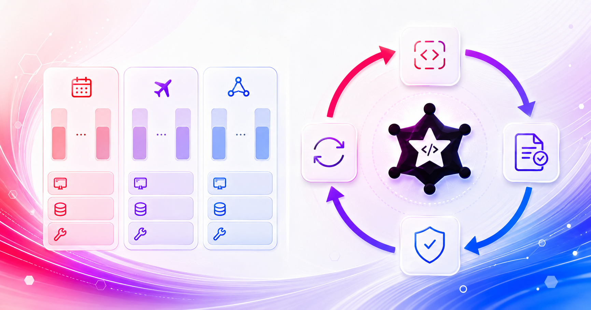
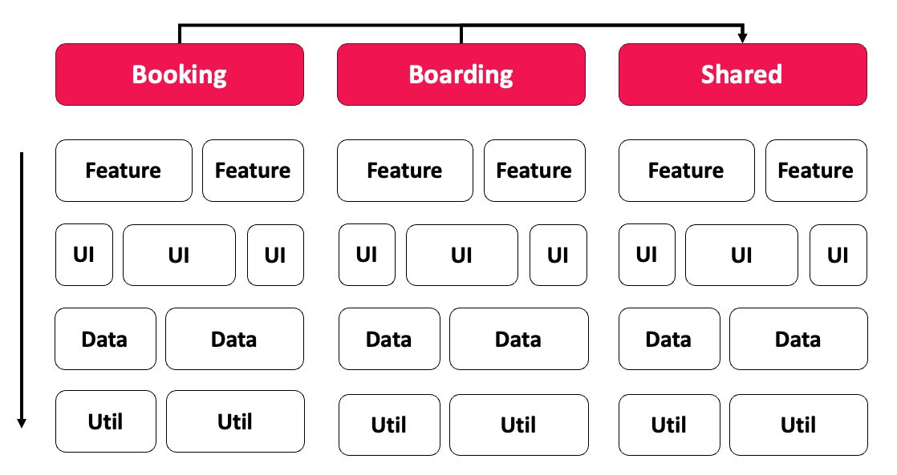
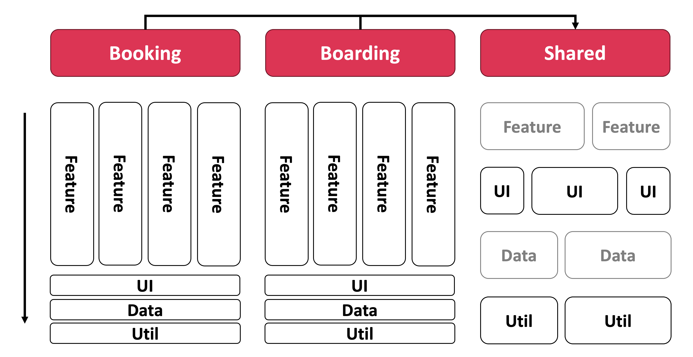
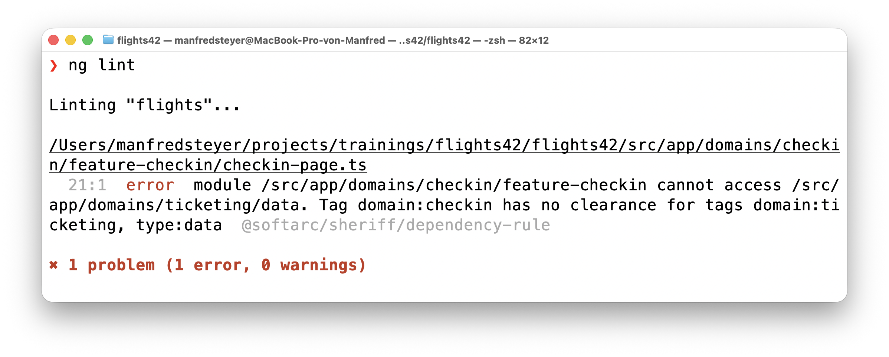
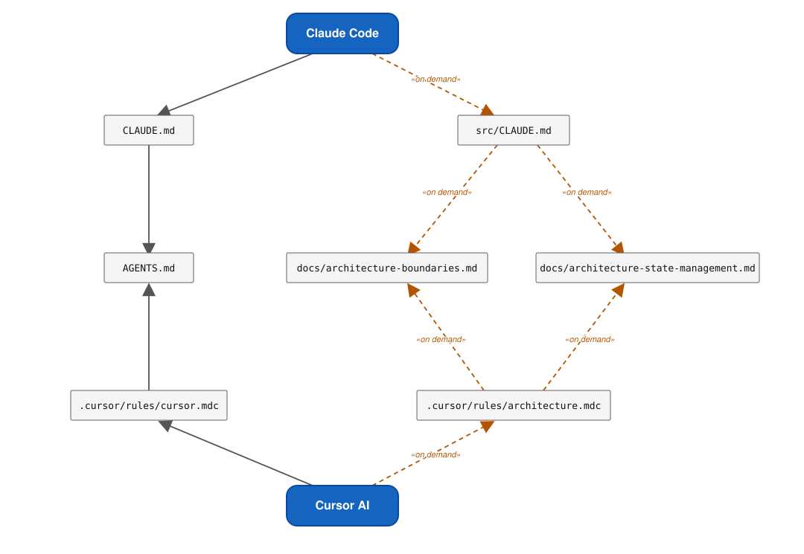
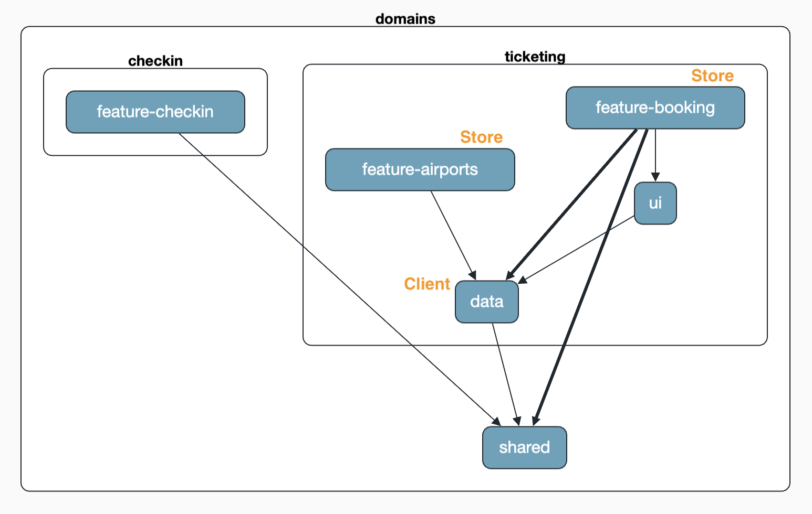
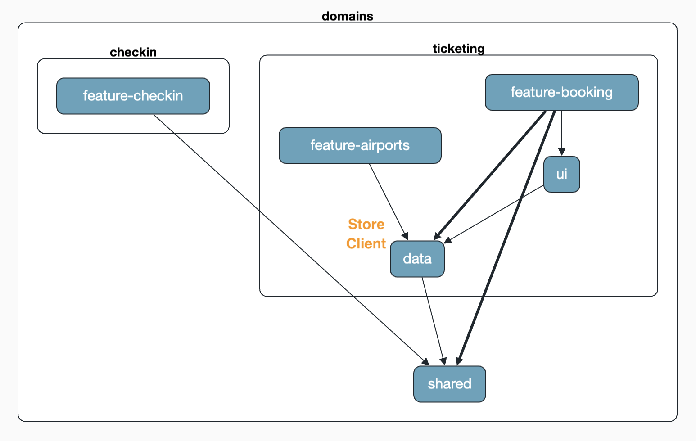
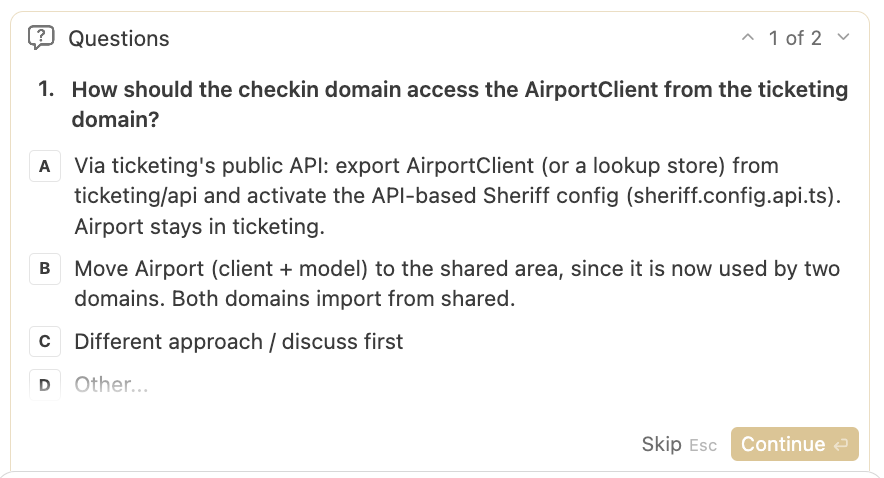
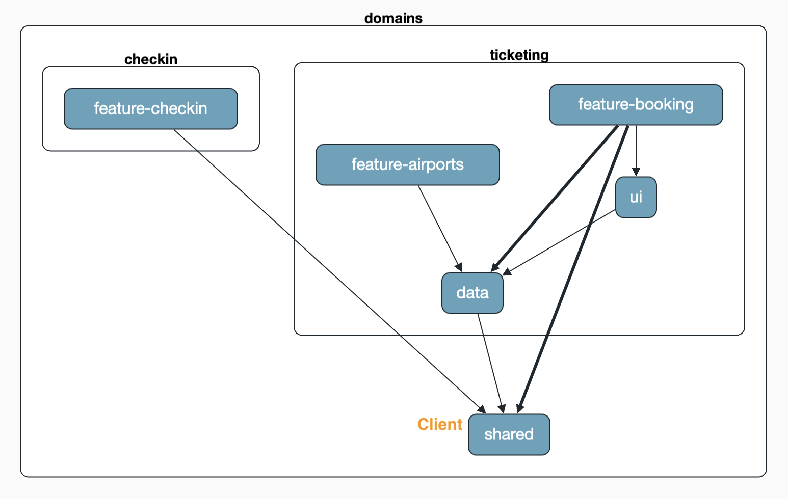
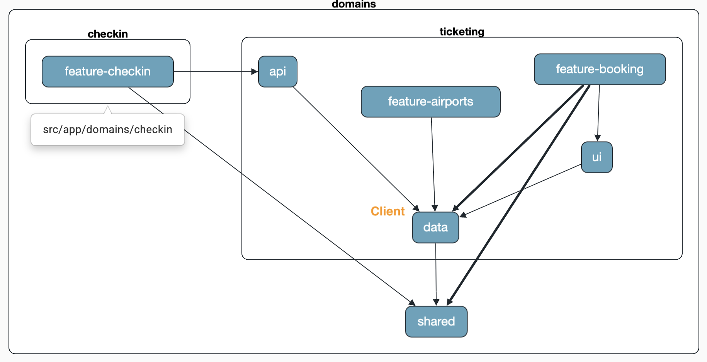

# AI-Assisted Coding: Architecture as an Executable Contract

*June 1, 2026 | Article by Manfred Steyer*

Source : <https://www.angulararchitects.io/en/blog/reliable-angular-architectures-with-ai-assisted-coding/>



This is post 1 of 2 in the series *“AI-assisted Angular Architecture”*

1.  AI-Assisted Coding: Architecture as an Executable Contract
2.  [Architecture Beyond Layers: tsarch for AI Coding Agents](https://www.angulararchitects.io/en/blog/architecture-beyond-layers-tsarch-for-ai-agents/)

Coding agents now write code faster than we can read it. That is great for speed – and acutely dangerous for the architecture. Because, by default, a language model optimizes for "it works", not for "it fits our target architecture". If no one steers against it, the quickly generated data access lands right inside the component, cross-references between domains creep in, and the painstakingly established structure softens commit by commit.

The good news: precisely these guardrails can be described today in a way that the coding agent not only knows but also follows – and so that it receives deterministic, machine-generated feedback on violations, which it uses to correct itself.

*AI-assisted coding needs architecture as an executable contract: documented in Rules, activated through task-specific context, checked by Sheriff, and fed back via Hooks.*

In this article I show what that looks like in practice. It is about **providing context for the architecture**, **integrating architecture checks like Sheriff into the AI's feedback loop**, and setting all of this up so that it works **across multiple platforms** such as Cursor AI, Claude Code, Codex (GPT), or Google's Antigravity CLI. We integrate the **official Angular Skills** and the **MCP server of the Angular CLI**, account for the **NgRx Signal Store**, add **custom Skills**, and in the end also bring in **ADRs** and other documented decisions.

📂 [Source Code](https://github.com/angular-architects/flights42/tree/ai-arc) (Branch: `ai-arc`)

## Target Architecture: Domains and Layers in Angular

Before an AI can adhere to an architecture, we have to define that architecture. Our example structures the application into **domains**: domains reduce cognitive load, because when working on a feature you only need to care about a manageable slice, and they support team organization, because responsibilities can be cleanly delineated.



The matrix shows the principle. Each column is a domain, each row a layer. A **Feature** is a business use case, typically with smart components that orchestrate the use case. **UI** contains reusable, "dumb" components. **Data** takes care of data access and data models, **Util** of technical helper functions. Cutting across all of this, there is a **Shared** domain for code that several domains need.

The permitted accesses are decisive: layers may only access one another from top to bottom (`feature → ui → data → util`), and **domains do not access one another directly**. Anyone who needs code from another domain either uses the Shared domain or an API that offers targeted access to selected parts of a domain.

Building on this, we rely on **Feature Slicing**. The idea is locality: code that belongs only to one feature also lives in the feature folder – including feature-local dumb components, stores, and helper functions. This keeps cognitive load low, because related code sits together. The downside is just as real: if local code is suddenly needed elsewhere, it has to be refactored, that is, moved into a more global area. We will see later how exactly this moving can be nicely automated with AI-assisted coding.



The image makes clear that Feature Slicing is not all that far from the pure matrix. It simply additionally allows feature-local UI, Data, and Util building blocks that only move into a deeper, shared layer once they are actually needed by several features.

## Validating the Architecture Matrix with Sheriff

An architecture that exists only in a presentation does not survive a single sprint. That is why we enforce the matrix with [Sheriff](https://github.com/softarc-consulting/sheriff). Sheriff assigns tags to folders – such as `domain:ticketing` and `type:data` – and defines rules about which tags may access which. If you don't comply, you get a linting error: right as you type in the IDE and on the console.



The message is pleasingly concrete: the module `domains/checkin/feature-checkin` may not access `domains/ticketing/data`, because `domain:checkin` has no permission for `domain:ticketing, type:data`. It is exactly this precision that is the key to the next step – because such an error is not only feedback for developers, but also excellent, deterministic feedback for the language model. We will see in a moment how the coding agent picks up this message and corrects its code on its own.

How to set up such an architecture with Sheriff and standalone components in detail is described in the article [Modern Architectures with Angular – Strategic Design with Sheriff](https://www.angulararchitects.io/en/blog/modern-architectures-with-angular-part-1-strategic-design-with-sheriff-and-standalone-components/).

## Providing Context: Rules

A coding agent is only as good as the context it gets. Without explicit guidance the model guesses – and when in doubt it guesses the mainstream style from its training data, not our conventions. Context is therefore not a nice-to-have, but the prerequisite for generated code to fit our architecture at all.

Angular itself provides the entry point. The framework generates an `AGENTS.md` with the most important cornerstones for modern Angular – signals, standalone components, `inject()`, native control flow, and much more. That is an excellent starting point that we don't have to reinvent.

Cursor AI reads its guidelines from the `.cursor/rules` folder. So that we don't duplicate rules, our Cursor-specific rule `cursor.mdc` points to `AGENTS.md` as the authoritative source:

```markdown
---
alwaysApply: true
---

Always follow the guidelines defined in the `AGENTS.md` file in the project root.
It is the authoritative source for coding standards, conventions, and best practices.
In case of conflicts, the rules in `AGENTS.md` take precedence.
```

The `alwaysApply: true` in the frontmatter ensures that this rule applies to every request – and the actual content only points to `AGENTS.md`. This already brings clear roles for the individual artifacts into focus:

- `AGENTS.md` contains the red lines and short references – not the full detailed rules.
- `docs/architecture-boundaries.md` is the source of truth for domains, layering, feature slicing, shared code, public APIs, and Sheriff rules.
- `docs/architecture-state-management.md` is the source of truth for store and state-management conventions.

So the full detailed rules should not be duplicated in `AGENTS.md`. In short:

*Docs contain the binding architecture and coding rules. AGENTS.md names the most important red lines and points to the relevant rules. Task-specific context is only pulled in when the task at hand needs it.*

Behind this is a deliberate decision about context size: the more that permanently sits in the prompt, the higher the cost, the distraction, and the risk of context pollution. That is why only short always-on rules belong in `AGENTS.md` or in always-on rules. The detailed rules stay in `docs/architecture-boundaries.md` and `docs/architecture-state-management.md` and are read for matching tasks or activated via rules, prompts, or – later – Skills. We pick up this idea again in the section on Skills.

In Cursor, rules can apply permanently, take effect via file patterns, be selected by the agent based on their description, or be referenced explicitly. With that, `.mdc` files already move toward task-specific context steering: short red lines stay visible at all times, detailed rules are only activated when the task needs them. Concretely, the `.mdc` files under `.cursor/rules` point to `docs/architecture-boundaries.md` and `docs/architecture-state-management.md` and help the agent take them into account for matching tasks.

With other tools like Claude Code we achieve the same effect via prompting: in local instruction files we tell the agent what to load when – for example `docs/architecture-boundaries.md` for structural changes and `docs/architecture-state-management.md` for store tasks. Instead of carrying every detailed rule along permanently, the matching rule is pulled in for the matching task. We'll look at the concrete implementation via `CLAUDE.md` and `src/CLAUDE.md` further below.

The full files can be looked up on GitHub if needed: [`architecture.mdc`](https://github.com/angular-architects/flights42/blob/ai-arc/.cursor/rules/architecture.mdc), [`docs/architecture-boundaries.md`](https://github.com/angular-architects/flights42/blob/ai-arc/docs/architecture-boundaries.md), and [`docs/architecture-state-management.md`](https://github.com/angular-architects/flights42/blob/ai-arc/docs/architecture-state-management.md).

## General Architecture Rules

With the architecture rules, the decisive thing is that we capture the tricky spots unambiguously. The most important rules in brief:

- The **Sheriff configuration** may only be changed on explicit request. In particular, it may not be weakened just to satisfy the linter.
- **Feature Slicing:** feature-local code is to be preferred. If it is later needed elsewhere too, it is to be moved into a deeper layer.
- **New domains** may only be added on explicit request. The model may, however, propose new domains.
- **Moving code into the Shared area** is only allowed if the user agrees to it or explicitly requests it. The rule of thumb: shared is a deliberate architectural decision, not a fallback folder for import problems.
- The same applies to **publishing code for other domains via APIs**. In this case, additional Sheriff rules allow access to an `api/index.ts` with selected exports in a neighboring domain.
- New code for new use cases should follow the structure of a few already existing, good **reference use cases** (such as `FlightSearch` and `FlightEdit`). In practice this has proven surprisingly effective.

## Specific Rules for State Management

The rules for the Signal Store are explicit as well. Among other things, they specify:

- From the [NgRx Toolkit](https://ngrx-toolkit.angulararchitects.io/), use `withResource`, `withMutations`, and the dev tools support (`withDevtools`).
- The store delegates data access to a data-access service and does not access the backend itself.
- There are clearly delineated kinds of stores: for the **entities of a search list** (`<Entity>SearchStore`), for the **entity of a detail view** (`<Entity>DetailStore`), for **lookup entities** or suggestion values (`<Feature>LookupStore`), and for **UI state**.
- A store only gets access to another store if the user agrees.

## Naming Conventions

Not every guideline can be sensibly expressed through layering and Sheriff. If you tried, the configuration would quickly become unwieldy. That is why we additionally rely on naming conventions that are easy to describe and easy for the model to check.

A good example is access to the store. Only **smart components** may use a store, and in our project you recognize smart components by the suffixes `Page`, `Search`, `Detail`, and `Edit` – such as `FlightSearch` or `FlightEdit`.

These conventions are likewise captured in the rules. Especially now that, in modern Angular, components no longer carry the not-very-meaningful default suffix `Component`, it pays off to use suffixes for such semantics – for human and machine alike.

## Context on Demand: Angular Skills and MCP Servers

If we put the entire context into the prompt all the time, it would quickly become overloaded, expensive, and unwieldy. With rules we already use case-specific loading in part: in Cursor, for example, via file patterns, descriptions, or explicit references, and with Claude Code via corresponding prompting rules. **Skills** take this idea further by bundling task-specific knowledge and recurring workflows.

Skills thus encapsulate task-specific knowledge and concrete workflows. Depending on the tool, they can be activated automatically or explicitly. This leads to a clear division of labor:

*Docs contain the binding architecture and coding rules. Skills describe how an agent should proceed for specific tasks. AGENTS.md names the most important red lines and points to the relevant rules.*

Skills therefore point to the docs but do not duplicate them: `docs/architecture-boundaries.md` and `docs/architecture-state-management.md` remain the binding detailed rules, while a Skill describes the matching workflow for them.

The Angular community provides official Skills that are regularly adapted to the respective current framework version. We install them with the Skills CLI:

```bash
npx skills add https://github.com/angular/skills
```

This places the Skills `angular-developer` and `angular-new-app` in the `.agents/skills/` folder – a convention that has established itself across tools. A `skills-lock.json` records which version is installed, so that updates can be applied in a traceable way.

This very pattern can be applied to our own rules. For the state-management conventions from `docs/architecture-state-management.md`, a task-specific `signal-store` Skill is a good additional fit. The `docs/architecture-state-management.md` remains the binding source for store conventions; the Skill points to it and describes the concrete workflow for typical tasks: when a new store makes sense, which store type to choose, where the store should live, which existing stores serve as references, and which checks to run after the change. So the rule itself stays in the project documentation; the Skill describes how the agent should concretely proceed on store tasks.

By the way, the same pattern can be applied to the architecture rules as well: instead of activating `docs/architecture-boundaries.md` only via file-pattern rules and prompting, a dedicated architecture Skill could just as well take on this job and kick in on structural changes. The role separation remains decisive – the Skill describes the workflow and points to the docs as the binding source; it does not become the source of truth itself. The rule therefore still lives in `docs/architecture-boundaries.md`, and the Skill merely points to it.

In addition, the **MCP server of the Angular CLI** is useful. MCP (Model Context Protocol) is an open standard through which a coding agent can access external tools and knowledge sources. Among other things, the Angular MCP server provides the agent with well-curated examples and access to the current documentation – ideal for hitting best practices even when the model's training data is already somewhat dated.

In Cursor AI we set up the server via the file `.cursor/mcp.json`:

```json
{
  "mcpServers": {
    "angular-cli": {
      "command": "npx",
      "args": ["-y", "@angular/cli", "mcp"]
    }
  }
}
```

With that, the Angular MCP server is available to the agent as soon as it needs it.

## Bringing Architecture Checks into the AI Feedback Loop via Hooks

Up to here we have taught the model a lot. But knowledge alone is not enough – we need a deterministic safety net that checks every round of the agent. That is exactly what **Hooks** are for.

A **stop hook** kicks in when the agent thinks it is done, and beforehand runs a Node script that runs the linter, tests, and build. Sheriff is also integrated via the linter – so our architecture matrix is checked by machine on every round.

From the outset we separate the actual check logic from the tool-specific wiring: a shared check core returns a neutral result, and a lean hook script per tool translates it into that tool's conventions. This lets us effortlessly extend the setup to multiple coding agents in the next section.

The actual check logic forms the core and lives in `scripts/ci-checks.mjs`. It knows only the checks themselves – nothing about exit codes or `stdout`/`stderr`:

```js
import { execSync } from 'node:child_process';

const fastSteps = [
  'npx ng lint flights',
  'npm run test:arch',
  'npm run test:scripts',
];

const fullOnlySteps = [
  'npx ng test flights --configuration ci',
  'npx ng build flights',
];

// Runs the CI steps in order and stops at the first failing one.
// Returns a discriminated result instead of throwing so callers can map it
// to whatever their environment expects (exit code, JSON payload, ...).
export function runChecks({ full = false, capture = false } = {}) {
  const steps = full ? [...fastSteps, ...fullOnlySteps] : fastSteps;
  for (const step of steps) {
    try {
      execSync(step, capture ? { encoding: 'utf8' } : { stdio: 'inherit' });
    } catch (error) {
      const out = capture
        ? [error.stdout, error.stderr].filter(Boolean).join('\n').trim()
        : '';
      return {
        status: 'error',
        message: `Check failed: ${step}\n\n${out || error.message}`,
      };
    }
  }
  return { status: 'success' };
}
```

`runChecks` runs the steps one after another and deliberately distinguishes between fast checks (lint including Sheriff as well as architecture and script tests) and the more expensive steps (unit tests and build), which are only added with `full`. Instead of throwing on failure, the function returns a **discriminated result** – `{ status: 'success' }` or `{ status: 'error', message }` with the collected output. This lets every caller translate the result into exactly what its environment expects (exit code, JSON payload, …). Via `capture` we control whether this output is gathered for the later feedback to the model (`capture: true`) or passed straight through to the console.

The tool-specific part is handled by a small, dedicated hook script per coding agent: it calls `runChecks` and translates the result into its tool's conventions. Apart from the check core, all they share is a tiny helper that reads the tool's context from `stdin` (`scripts/hooks/read-input.mjs`):

```js
import process from 'node:process';

export async function readInput() {
  const chunks = [];
  for await (const c of process.stdin) {
    chunks.push(c);
  }
  try {
    return JSON.parse(Buffer.concat(chunks).toString() || '{}');
  } catch {
    return {};
  }
}
```

For Cursor the hook script looks like this (`scripts/hooks/cursor-stop-hook.mjs`):

```js
import process from 'node:process';

import { runChecks } from '../ci-checks.mjs';
import { readInput } from './read-input.mjs';

const input = await readInput();

if (input.status !== 'aborted') {
  const result = runChecks({ capture: true });
  if (result.status === 'error') {
    process.stdout.write(JSON.stringify({ followup_message: result.message }));
    process.exit(0);
  }
}

process.stdout.write('{}');
process.exit(0);
```

Here Cursor's convention shows immediately: if the run was aborted (`status === 'aborted'`), the script skips the checks. Otherwise `runChecks` runs; if it reports an error, the message moves into a JSON object on `stdout` as `followup_message` – exactly this field is what Cursor replays to the agent as its next task. In every other case the hook returns an empty JSON object. The exit code stays `0` throughout; Cursor decides how to proceed based on the output.

The hook is registered in `.cursor/hooks.json` – we now point to the Cursor hook script instead of directly to the check script:

```json
{
  "version": 1,
  "hooks": {
    "stop": [
      {
        "command": "node scripts/hooks/cursor-stop-hook.mjs",
        "timeout": 600,
        "loop_limit": 3
      }
    ]
  }
}
```

If one of the checks fails – for example because Sheriff reports an architecture violation, a test is red, or the build breaks – the agent goes into a new round. It receives the error message as input and tries to fix it. The `loop_limit` of three limits how often this loop repeats, so that the agent doesn't circle endlessly.

The staggering of checks mentioned above is already built into the script: by default only the fast checks like lint and Sheriff run; the more expensive steps – full tests and build – are only added via `full`, for example for bigger changes or before the merge. This keeps the safety net in place without making every round unnecessarily expensive.

The fact that it is a **Node script** is a deliberate decision: this way the same check runs platform-independently on macOS, Linux, and Windows.

A small but important difference in the behavior of the tools: Cursor reports visibly when the script is executed. Claude Code does not – there you only notice it when an error occurs.

NOTE

### Modern Angular

You'll find more on Signal Forms and modern Angular architecture in my new eBook Modern Angular. It covers signals, architecture, testing, AI assistants, and practical solutions for modern business applications.

[](https://www.angulararchitects.io/modern-book)

[More about the book →](https://www.angulararchitects.io/modern-book)

## Serving Cursor AI and Claude Code from a Single Source of Truth

It is not uncommon for developers to be allowed to choose their own tools. And this is exactly where a practical problem lurks: different environments expect Rules, Skills, and MCP servers in different folders and under different file names. With Claude Code, for instance, Rules live in `CLAUDE.md`, Skills under `.claude/skills/`, and MCP servers are configured in `.mcp.json`.

But we want to keep **a single source of truth** rather than maintaining every guideline multiple times. The solution depends on the respective artifact.

For the **Rules** we solve it elegantly via references: the `CLAUDE.md` in the project root essentially consists only of a reference to `AGENTS.md`:

```markdown
@AGENTS.md
```

In addition, a `src/CLAUDE.md` points to the architecture documentation. So there is still only one authoritative source that all tools point to.

```markdown
Before changing application or library code here, read `docs/architecture-boundaries.md` and apply the architecture rules.

If the change touches state management, also read `docs/architecture-state-management.md` when it exists.

Do not bypass documented domain boundaries. Prefer small, focused changes.
```

This is the concrete implementation of the prompting approach mentioned earlier: instead of "always read all architecture rules", we phrase the guidance case-specifically. In effect: use `docs/architecture-boundaries.md` when you make structural changes – for example to domains, layers, imports, shared code, public APIs, or Sheriff rules. Use `docs/architecture-state-management.md` when you create or change stores. This way not every detailed rule sits in the context permanently, but is pulled in for the matching task.

The following image summarizes how Claude Code and Cursor AI obtain their context: both always load their entry rules (`CLAUDE.md` and `cursor.mdc`, respectively) and thus the `AGENTS.md`, while the detailed `docs/` files are loaded only on demand.



For **Skills and MCP configuration** this reference trick does not work – here the files actually have to live in both places. Symlinks would be the obvious choice, but they behave differently between Windows and Linux/macOS and, in our experience, cause friction. That is why we instead copy the files with a small [Node script](https://github.com/angular-architects/flights42/blob/ai-arc/scripts/sync-agent-config.mjs). It mirrors `.agents/skills/` to `.claude/skills/` and `.cursor/mcp.json` to `.mcp.json`.

So that no one accidentally edits the generated copies, the script additionally creates two `DO_NOT_EDIT` files – one in the mirrored Skills folder and one for the MCP configuration. They point out unmistakably that changes here will be overwritten on the next sync and must instead be made in the respective source.

So that the script runs reliably, we hook it into the usual lifecycles: it is executed via npm's `prepare` script (that is, after `npm install`) and additionally triggered via a pre-commit hook as soon as one of the sources has changed. This way the copies stay up to date automatically, without anyone having to think about it.

And finally the **stop hook**: we feed it from a single source too. Now, with the second tool, it becomes clear what we planned the indirection for – because **every coding agent has its own conventions for how a stop hook communicates with it.** The differences mainly concern two things. First, the **exit code** – that is, the return value with which a process reports its result to the calling tool (for operating-system processes one speaks of exit code or exit status, not "result code"). Claude Code, for example, treats an exit code of `2` as "block and retry", whereas Cursor expects exit code `0` even on failure and decides how to proceed based on the output. Second, the **use of `stdout` and `stderr`**: Cursor reads a JSON object from `stdout` and expects the feedback to the model in a specific field; Claude Code, on the other hand, takes the text from `stderr` as feedback for the agent. Some tools additionally pass context to the hook via `stdin` – for example whether the run was aborted.

These are exactly the differences each hook script absorbs: the check core in `ci-checks.mjs` (and the small `read-input.mjs`) remains unchanged – for Claude Code we only add a second, equally lean hook script (`scripts/hooks/claude-stop-hook.mjs`):

```js
import process from 'node:process';

import { runChecks } from '../ci-checks.mjs';

const result = runChecks({ capture: true });

if (result.status === 'error') {
  process.stderr.write(result.message);
  process.exit(2);
}

process.exit(0);
```

Here Claude's convention comes through: instead of a JSON object on `stdout`, Claude Code uses the **exit code** as the signal – `2` means "block and replay the text from `stderr` as feedback to the agent". So the few lines merely translate the result into Claude's expectations; the entire check core stays shared.

With Claude Code the hook is registered not via a dedicated hook file but in `.claude/settings.json`:

```json
{
  "hooks": {
    "Stop": [
      {
        "matcher": "",
        "hooks": [
          {
            "type": "command",
            "command": "node scripts/hooks/claude-stop-hook.mjs",
            "timeout": 600
          }
        ]
      }
    ]
  }
}
```

This way Cursor AI and Claude Code share the same check core and differ only in a few lines of their respective hook script.

## Extending to GPT, Codex CLI, Google Antigravity, and Beyond

Many current coding agents and agent tools now orient themselves around similar conventions: an `AGENTS.md` describes project-wide instructions, Skills often live in a dedicated Skills directory, and MCP servers are registered via tool-specific configuration files. The details, however, differ from tool to tool – for example with hooks, local instruction files, or the MCP configuration. For instance, Codex expects the MCP configuration in a TOML file (such as `.codex/config.toml`), while Antigravity uses a JSON format (such as `mcp_config.json`).

That is why we treat `AGENTS.md`, `.agents/skills/`, and our MCP base configuration as central sources and let a small sync script generate the required target formats from them. When another tool is added, usually only this script has to be extended. Since the script is deliberately kept simple, this very adjustment is an excellent fit for AI-assisted coding: the agent can look up the documentation of the new tool, derive the required target format, and extend the sync script accordingly.

There are by now ready-made tools for exactly this task, such as [rulesync](https://github.com/dyoshikawa/rulesync) and [ruler](https://github.com/intellectronica/ruler). They maintain rules, skills, MCP servers – sometimes even hooks – from a central configuration and distribute them to the respective coding agents. We nevertheless deliberately opted for the lightweight in-house solution here: this keeps the de-facto standards `AGENTS.md` and `.agents/skills/` as our immediate source of truth, instead of binding the setup to a tool's own source format (such as a central `.rulesync/` directory). For anyone who has many agents and artifact types to synchronize anyway, these tools may be the better choice – for our modest setup, the benefit of working directly on the established standard files outweighs that.

The same principle applies to the **stop hooks**. Because the actual check logic in `ci-checks.mjs` (and the small `read-input.mjs`) is tool-neutral, another tool usually costs only a new, few-line hook script that serves its conventions for exit code and `stdout`/`stderr` – plus registering it in the expected location. This too is an ideal task for AI-assisted coding: the agent reads the new tool's hook documentation and derives the matching hook script from it.

This is exactly where language models play to their strength: they are remarkably good at adapting our existing setup to the current conventions of additional coding agents. You can simply ask the agent to consult the documentation of the new tool, derive the matching target format, and extend the sync script accordingly – so connecting another tool itself becomes a task for AI-assisted coding.

## AI-assisted Coding in Action: Generating a New Feature

Enough theory – let's see the setup in action. In the coding agent we request that we also want to manage **Airports** going forward. For simplicity, these are kept directly in memory, in a data-access service named `AirportClient`. In addition, we want to be able to select the airports from dropdown fields when maintaining flights.



The result is impressive. The two features `airports` and `booking` each get their own store – and that is exactly right, because the features have different state. A filter in one feature should not affect the other. (If that were desired after all, we would have to reflect it in `architecture-boundaries.md`.) Both stores, however, use the same `AirportClient` in the data layer.

If the agent were to violate a linting rule such as a Sheriff-based architecture constraint – or if tests or the build failed – the IDE would automatically go into a new round thanks to the stop hook, until the checks are green.

It gets exciting when we vary the requirements. If we explicitly state that we want the same store in both features, the coding agent moves the store into the data layer on its own – exactly as we described it in `architecture-boundaries.md`. In doing so, it incidentally solves one of the central challenges of Feature Slicing: the refactoring, that is, moving local code into more global areas once it actually becomes necessary.



As long as we stay within the same domain, the agent may refactor the code according to the documented rules – such as the move of the store into the data layer shown earlier. It gets even more interesting when we also want to reuse the `AirportClient` in the `checkin` domain. Now domain boundaries are affected, and exactly then the agent has to ask. The agent confronts us with a question – and that is intentional. In `architecture-boundaries.md` we specified that in exactly this case consultation is required, because cross-domain access is a deliberate architectural decision. Possible options are then, for example: move the code to `shared`, publish it via a public API of the `ticketing` domain, or cut the requirement differently.



If we decide to move the `AirportClient` into the shared area, the result looks like above: both domains now access the shared code in `shared`.



If we instead choose the API path, the `AirportClient` stays in the `ticketing` domain and is published via an `api/index.ts`. To this end, the agent adjusts the Sheriff configuration so that `domain:checkin` gets access to `domain:ticketing/api` – but only to the selected, released elements there:



## Refining Rules and Skills Iteratively

An honest assessment is part of the picture: creating good Rules and Skills is not a one-time act, but an **iterative process**. If the agent does something you don't want, these files need to be sharpened and made more concrete. By the way, language models and coding agents help excellently with this too – you can simply ask them to turn an undesired behavior into a more precise rule.

In our experience, it also depends strongly on the model used how strictly and explicitly you have to phrase things. Some models follow even brief hints, others need unambiguous, almost pedantic guidance. It pays off to calibrate the rule set to the model actually in use.

## Saved Prompts and Plan Mode

From practice, two more recommendations that can make the difference between frustration and flow. First, I've had good experiences with **saved prompts** that I pull into the chat when needed. This helps enormously with iterative refinement and especially with analogous follow-up tasks.

Second, I like to first have the agent explicitly **plan** – via the plan mode that many IDEs now offer – and only then release the plan for implementation. This way misunderstandings can be cleared up before a single line of code is written.

## Custom Skills: Running an Architecture Review

Refined prompts can also be developed into custom Skills. We are not limited to generating code here – we can also use them for recurring tasks such as an **architecture review**. Our own Skill for this lives under [`.agents/skills/architecture-review/SKILL.md`](https://github.com/angular-architects/flights42/blob/ai-arc/.agents/skills/architecture-review/SKILL.md) and is deliberately compact:

```markdown
---
name: architecture-review
description: Review Angular code against the repository architecture rules in docs/architecture-boundaries.md, including Sheriff boundaries, layering, feature slicing, shared code, and state management conventions.
---

# Review Angular Architecture

Use this skill when reviewing Angular code for architectural quality.

Before reviewing, read:

- `docs/architecture-boundaries.md`
- `AGENTS.md` if present
- `docs/architecture-state-management.md` if state management is involved
- the relevant Sheriff configuration
- the changed files and their imports

Treat `docs/architecture-boundaries.md` as the source of truth.
...
```

The Skill makes `docs/architecture-boundaries.md` the authoritative source, prescribes a clear review process, and describes the desired output format – from the summary, through findings by severity, to the concrete fix. This turns a vague "have a look" into a reproducible review.

The review is started with a simple prompt:

    Perform an architecture review for the new airport-related features (skill architecture-review).

You don't strictly have to name the Skill. But anyone who wants to make absolutely sure that the coding agent uses exactly this Skill can name it explicitly.

## More Context: ADRs and MCP Servers for Confluence and Co.

Architectural decisions almost always have a backstory: why relaxed layering? Why Feature Slicing? Teams capture these rationales in **Architecture Decision Records (ADRs)**. In the branch `ai-arc-adr` we bring in such ADRs – for example around relaxed layering, domains, Feature Slicing, and state management.

Here it matters not to stuff the agent's context unnecessarily full. If we delivered all ADRs permanently, it would come at the cost of clarity and token budget. That is why we **derive concise rules from the ADRs** – this too works well with language models – and **link** from these rules back to the detailed ADRs, so that the coding agent can look things up when needed. In `docs/architecture-boundaries.md` this looks roughly like:

```markdown
## Shared Code

_(derived from [ADR-0004](adr/0004-feature-slicing-and-shared-code.md))_

- Promote code to a shared area only when at least two independent features require it.
- Avoid premature shared abstractions.

## State Management

_(derived from [ADR-0003](adr/0003-ngrx-signal-store-for-state.md))_

- Follow `docs/architecture-state-management.md` where applicable.
```

So the rule sits compactly in the context, while the rationale remains a click away. This keeps the prompt lean and still makes decisions traceable.

Beyond ADRs in the repository, it pays to take a look at the tool landscape: platforms like Confluence now offer MCP servers as well. With them, the agent can, when needed, directly access decisions and guidelines documented there – without us having to copy them into the repository.

## Conclusion

Reliable architectures do not emerge on their own with AI-assisted coding – they are the result of deliberately provided context. It pays to separate the roles clearly:

*Rules say which project rules must be visible. Skills describe how to work on a specific task. MCP provides access to external tools and knowledge sources.*

And we have to adapt to the different file conventions of various agents. To nonetheless keep a single source of truth, we use references and small scripts that copy files.

The core story can be summarized in a simple flow:

```text
define the architecture
→ provide context deliberately
→ check deterministically
→ feed errors back to the agent
→ the agent corrects itself
→ serve multiple tools from a single source of truth
```

At least as important is the feedback loop: a **Hook** that runs deterministic tools like Sheriff, tests, and build gives the agent a reliable, machine-generated corrective – and turns an architecture violation into an automatic correction round instead of technical debt.

In our example, a vertical architecture with domains and Feature Slicing has proven its worth. Even the classic challenge of Feature Slicing – later moving local code into more global areas – could be solved elegantly, because the agent takes on this refactoring itself based on clear rules and consults on tricky decisions.

And finally: it remains an iterative process. Rules and Skills grow with the experiences you gather with the respective model. Anyone willing to continuously sharpen these guardrails gets the best of both worlds – the speed of AI and the reliability of a well-thought-out architecture.

## Learn More: Angular Architecture Workshop: AI & Signals (Remote, Interactive, Advanced)

We have completely revamped our workshop and now put a special focus on AI-assisted Architecture and Signals. Become an expert in enterprise-wide and long-lived Angular applications with our Angular Architecture Workshop!

[](https://www.angulararchitects.io/en/training/advanced-angular-architecture-workshop/)

[German Version](https://www.angulararchitects.io/en/training/advanced-angular-architecture-workshop/) \| [English Version](https://www.angulararchitects.io/en/training/advanced-angular-architecture-workshop/)

## FAQ

**Why isn't it enough to explain the architecture to the coding agent once?**  
By default, a language model optimizes for working code, not for adherence to your target architecture. Without explicit, permanently available guidance (Rules) and a deterministic feedback loop (Hook with Sheriff, tests, build), the structure softens over time.

**How does the architecture feedback get back to the model?**  
Via a stop hook, the IDE runs a Node script that starts the linter (including Sheriff), tests, and build. If something fails, the agent automatically goes into a new round and corrects its code based on the concrete error message.

**How do you support multiple tools like Cursor AI and Claude Code at the same time?**  
Rules are bundled via references (e.g., `CLAUDE.md` points to `AGENTS.md`), so that there is a single source of truth. Skills and MCP configuration are copied to their respective expected locations via a Node script – deliberately rather than via symlink, since symlinks behave differently across operating systems.

**What is the difference between Rules, Skills, and MCP servers?**  
Rules say which project rules must be visible – short red lines permanently, detailed rules for the matching task. Skills bundle task-specific knowledge and concrete workflows and describe how an agent proceeds on specific tasks; depending on the tool, they are activated automatically or explicitly. MCP servers give the agent access to external tools and knowledge sources, such as the Angular documentation or documented decisions in Confluence.

**How do ADRs fit into the picture without overloading the context?**  
Concise rules are derived from the ADRs and live in the context; only a link points to the detailed ADRs. This keeps the prompt lean, and the agent can look up the rationale when needed.
