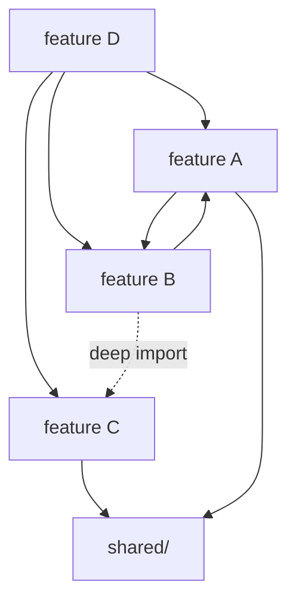
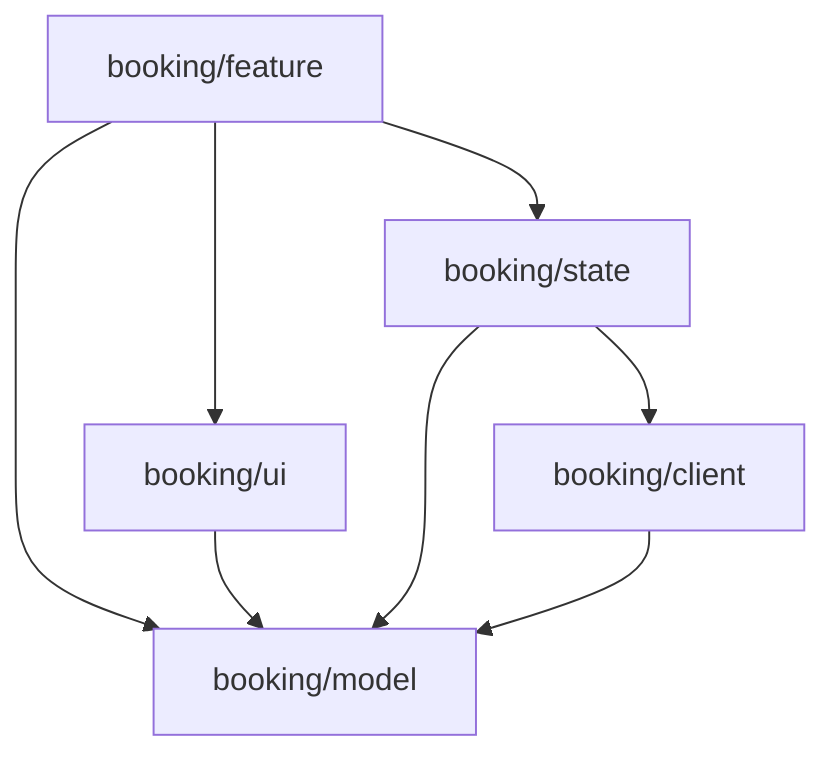
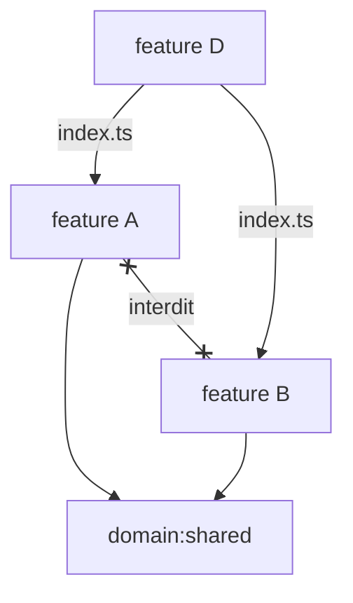
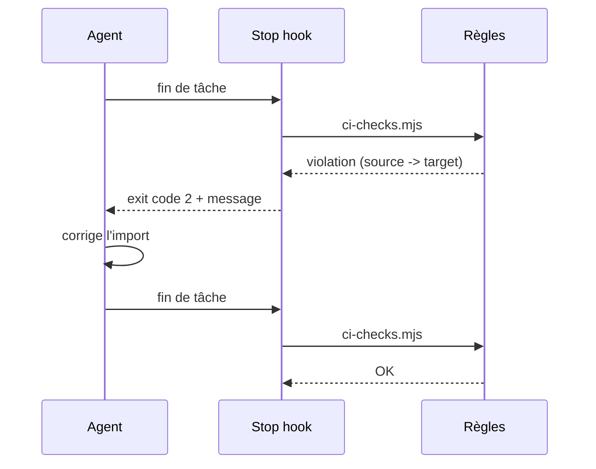

# Renforçons nos règles d'architecture frontend,<br/>pour les humains comme pour les agents 🏗️👮🤖

*Votre architecture n'existe que si elle est exécutable*

---
<a name="1.0"></a>
## Introduction & contexte


### Votre serviteur

- Benjamin Legrand /<!-- .element class="fragment"-->  `@benjilegnard`
- Front-end Architect / Tech Lead<!-- .element class="fragment"--> 
- onepoint<!-- .element class="fragment"--><span class="sky">.</span>
- Expertise<!-- .element class="fragment"-->  
Notes:
- je passe souvent sur des applis front où l'archi front laisse franchement à désirer
- voir il n'y A PAS d'architecture

---
<a name="6.0"></a>
## Conclusions, Limites <br/> et "plan du lundi matin"
Notes:
- je fais challenger par claude et il me sort ce concept à chaque fois
- comme si toute conf devait forcément être utilitariste


### Limites
- les suffixes sont une intention déclarée, pas une garantie
- les re-exports en barrel masquent les chaînes de dépendances à ts-arch
- parfois, les messages d'erreur sont laconiques (`source -> target`)
Notes:
- erreurs: ça compte quand le lecteur est un agent
- 

### Les échappatoires
- les échappatoires : comment on déroge, comment une règle évolue, qui valide


### Adopter: plan en 3 étapes
- taguer ses modules et activer les frontières
- n'activer que des 3 règles qui correspondent à une douleur déjà vécue
- brancher le stop hook et la CI


### Adopter: tips & tricks
- éviter de mettre en `error` des règles et partir en week-end
- parlez en entre vous, le top-down ne fonctionne pas
- partagez vos skills / docs & conventions en markdown dans git
Notes:


### Mode suppression d'eslint
// TODO


### Conclusion : 

> une règle d'architecture non exécutable n'est pas une règle, c'est un souhait


> le linter est votre meilleur ami, n'en faites pas un ennemi

Notes:
- et on a déjà des outils existants pour cadrer / vérifier ça
- moi ce que je voudrais c'est si vous avez des projets avec eslint, allez regarder ce que
- je passe en ce moment sur des projets ou y'a même pas de check CI, ou alors ça a suffisemment fait chier les devs pour qu'ils mettent des eslint-ignore partout
- appropriez-vous vos outils


### Sources des outils (github)
- [eslint/eslint](https://github.com/eslint/eslint)
- [ts-arch/ts-arch](https://github.com/ts-arch/ts-arch)
- [softarc-consulting/sheriff](https://github.com/softarc-consulting/sheriff)


### Inspiration


- Manfred Steyer
- <https://www.angulararchitects.io>
- [Reliable Angular Architectures <br/>with AI-Assisted Coding](https://www.angulararchitects.io/en/blog/reliable-angular-architectures-with-ai-assisted-coding/)
- [Architecture Beyond Layers: <br/>tsarch for AI Agents](https://www.angulararchitects.io/en/blog/architecture-beyond-layers-tsarch-for-ai-agents/)


### Merci !

<div style="display:flex;align-items:center;justify-content: space-between;">
    <a
        href="https://github.com/benjilegnard/frontend-architecture-for-humans-and-agents#readme"
        target="_blank"
    >
        
    </a>
    <div>
        ⬅️ Slides & démos 
        <br/><br/><br/>
        Feedback ➡️
    </div>
    <a
        href="https://openfeedback.io/VtrDATVvbl78SyeGnwPs/2026-10-16/cmugz7ijs005r01phz7q0n0c2 "
        target="_blank"
    >
        
    </a>
</div>

---

## Exemples mermaid


## Six mois plus tard



Notes:
Exemple mermaid : la feature D qui utilise A, B et C, et le spaghetti qui s'installe.


## Une feature, cinq rôles



Notes:
Exemple mermaid : les depRules Sheriff entre types (section 3.3).


## Les features entre elles



Notes:
Exemple mermaid : API publique par index.ts, dépendances unidirectionnelles, jamais de lien horizontal A ↔ B (section 3.4).


## La boucle de feedback de l'agent



Notes:
Exemple mermaid : le stop hook qui rattrape l'agent (section 5).

---

## Exemples de code


## ESLint : `HttpClient` dans les clients

```js
// eslint.config.js
{
  files: ['**/*.ts'],
  ignores: ['**/*-client.ts'],
  rules: {
    'no-restricted-imports': ['error', {
      paths: [{
        name: '@angular/common/http',
        importNames: ['HttpClient'],
        message: 'HttpClient uniquement dans les fichiers *-client.ts',
      }],
    }],
  },
}
```

Notes:
Règle 3.1 : le data access reste dans les `*-client.ts`.


## ts-arch : les cards restent dumb

```ts [|6|7-9|10]
import { filesOfProject } from 'tsarch';
import { expect, it } from 'vitest';

it('les cards ne dépendent ni des clients ni des stores', async () => {
  const rule = filesOfProject('tsconfig.arch.json')
    .matchingPattern(String.raw`-card\.ts$`)
    .shouldNot()
    .dependOnFiles()
    .matchingPattern(String.raw`-(client|store)\.ts$`);
  expect(await rule.check()).toEqual([]);
});
```

Notes:
Règle 3.1 : le nommage comme intention lisible par une machine. `check()` renvoie la liste des violations, ce qui marche avec n'importe quel runner (le matcher `toPassAsync()` n'existe que pour Jest).


## ts-arch : `ui` ne dépend pas de `state`

```ts
it('ui ne dépend pas de state', async () => {
  const rule = filesOfProject('tsconfig.arch.json')
    .inFolder('ui')
    .shouldNot()
    .dependOnFiles()
    .inFolder('state');
  expect(await rule.check()).toEqual([]);
});
```

Notes:
Règle 3.2 : elle ne détecte pas le props drilling, elle verrouille le pattern qui le rend inutile.


## Sheriff : domaines et types

```ts [|6-8|11|12-15]
// sheriff.config.ts
import { sameTag, SheriffConfig } from '@softarc/sheriff-core';

export const config: SheriffConfig = {
  entryFile: './src/main.ts',
  modules: {
    'src/app/<domain>/<type>': ['domain:<domain>', 'type:<type>'],
  },
  depRules: {
    root: 'type:feature',
    'domain:*': [sameTag, 'domain:shared'],
    'type:feature': ['type:ui', 'type:state', 'type:model'],
    'type:ui': 'type:model',
    'type:state': ['type:client', 'type:model'],
    'type:client': 'type:model',
  },
};
```

Notes:
Règles 3.3 et 3.4 : les placeholders taguent toute l'arbo d'un coup, `sameTag` interdit les liens entre domaines. Les deep imports sont bloqués par défaut : seul l'`index.ts` d'un module est accessible.


## Sheriff : dans l'IDE et en CLI

```js
// eslint.config.js
const sheriff = require('@softarc/eslint-plugin-sheriff');

module.exports = tseslint.config({
  files: ['**/*.ts'],
  extends: [sheriff.configs.all],
});
```

```bash
npx sheriff verify   # vérifie les règles
npx sheriff list     # liste les modules et leurs tags
```

Notes:
Même règles, deux boucles de feedback : à la frappe via ESLint, en CI via la CLI.


## ts-arch : pas de cycles

```ts
it('pas de dépendances circulaires', async () => {
  const rule = filesOfProject('tsconfig.arch.json')
    .inFolder('src/app')
    .should()
    .beFreeOfCycles();
  expect(await rule.check()).toEqual([]);
});
```

Notes:
Règle 3.4 : A importe B qui importe A. Alternative côté ESLint : `import/no-cycle`.


## ts-arch : le setup

```ts
// vitest.arch.config.ts
import { defineConfig } from 'vitest/config';

export default defineConfig({
  test: {
    include: ['arch/**/*.spec.ts'],
    environment: 'node',
    testTimeout: 60_000,
  },
});
```

```json
"test:arch": "vitest run --config vitest.arch.config.ts"
```

Notes:
`tsconfig.arch.json` est une copie du tsconfig principal : ts-arch ne résout pas `extends`.


## Le stop hook : Claude Code

```js [|4|6-7]
// scripts/hooks/claude-stop-hook.mjs
import { runChecks } from '../ci-checks.mjs';

const result = await runChecks();
if (result.status !== 'success') {
  process.stderr.write(result.message);
  process.exit(2);
}
```

```json
// .claude/settings.json
{ "hooks": { "Stop": [{ "hooks": [{
  "type": "command",
  "command": "node scripts/hooks/claude-stop-hook.mjs",
  "timeout": 600
}] }] } }
```

Notes:
Exit code 2 : Claude Code bloque l'arrêt et renvoie le stderr à l'agent comme feedback.


## Le stop hook : Cursor

```js
// scripts/hooks/cursor-stop-hook.mjs
const input = await readInput();
if (input.status !== 'aborted') {
  const result = await runChecks();
  if (result.status !== 'success') {
    process.stdout.write(JSON.stringify({ followup_message: result.message }));
    process.exit(0);
  }
}
process.stdout.write('{}');
process.exit(0);
```

Notes:
Même cœur `ci-checks.mjs`, autre convention : toujours exit 0, le `followup_message` devient la prochaine tâche de l'agent. `loop_limit: 3` dans `.cursor/hooks.json` borne les tentatives.
