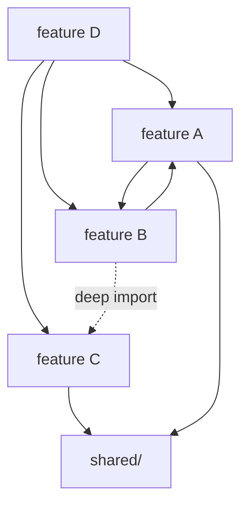
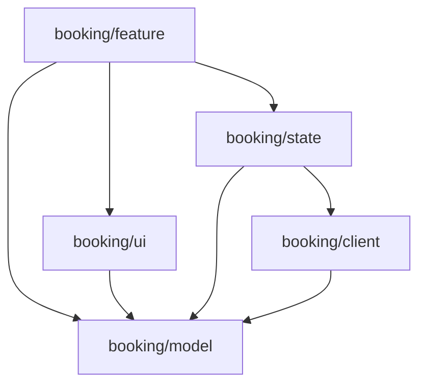
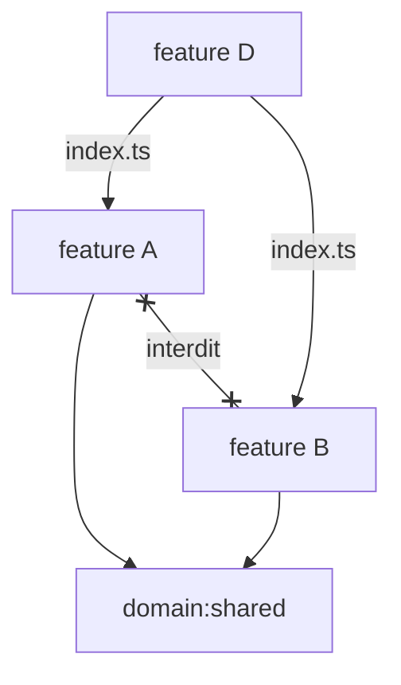
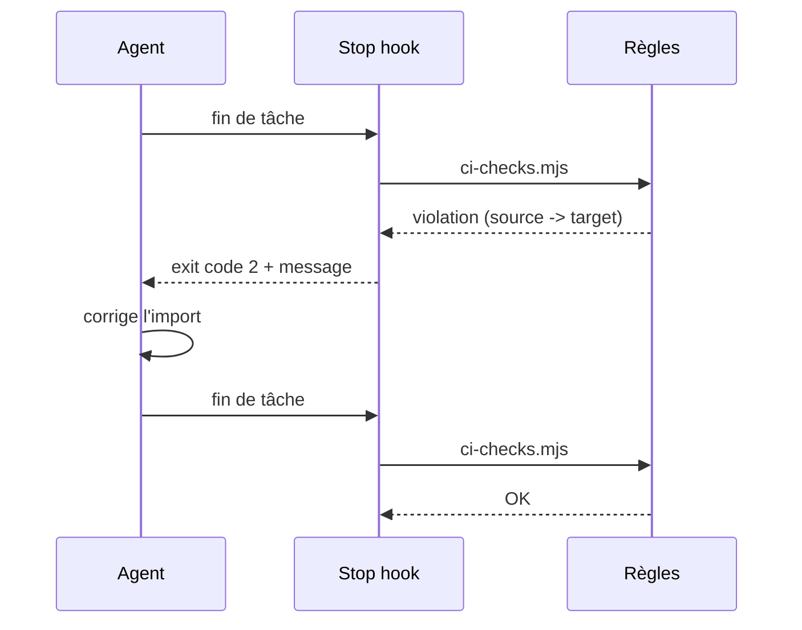

# Renforçons nos règles d'architecture frontend, pour les humains comme pour les agents 🏗️👮🤖

*Votre architecture n'existe que si elle est exécutable*

## Introduction

## Qu'est-ce qu'une bonne architecture frontend ?

---

## Exemples mermaid

## Six mois plus tard

Notes:
Exemple mermaid : la feature D qui utilise A, B et C, et le spaghetti qui s'installe.

## Une feature, cinq rôles

Notes:
Exemple mermaid : les depRules Sheriff entre types (section 3.3).

## Les features entre elles

Notes:
Exemple mermaid : API publique par index.ts, dépendances unidirectionnelles, jamais de lien horizontal A ↔ B (section 3.4).

## La boucle de feedback de l'agent

Notes:
Exemple mermaid : le stop hook qui rattrape l'agent (section 5).
