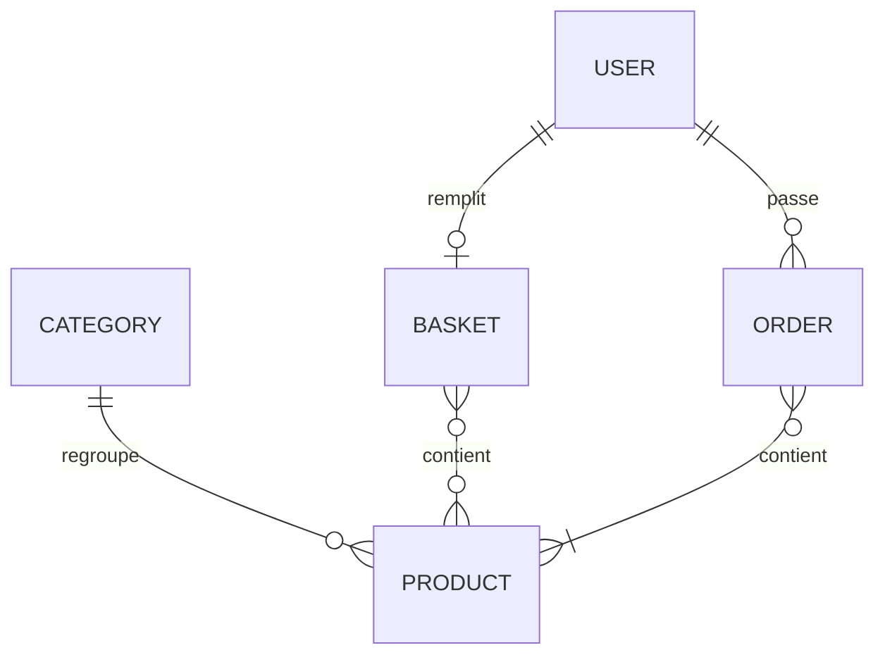
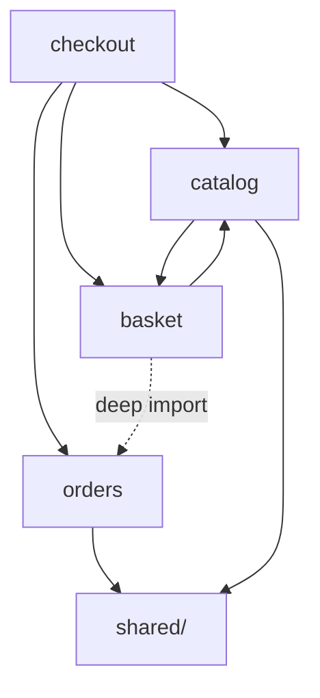
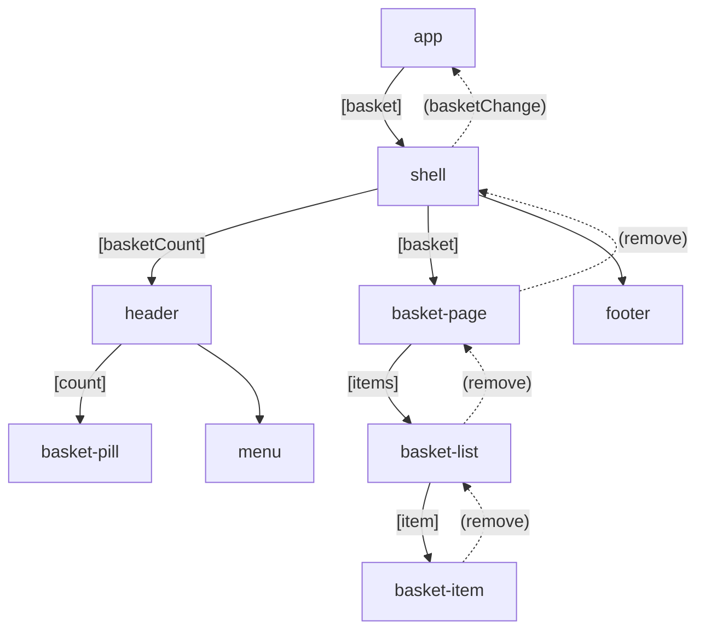
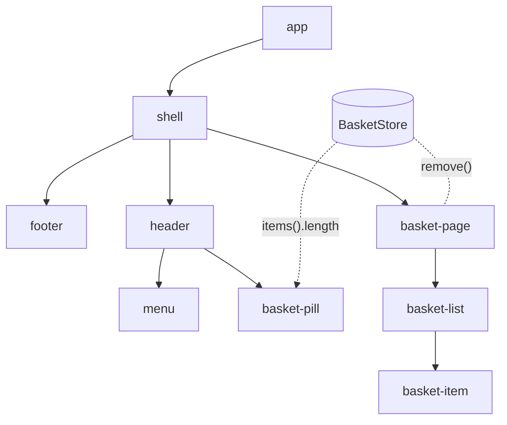
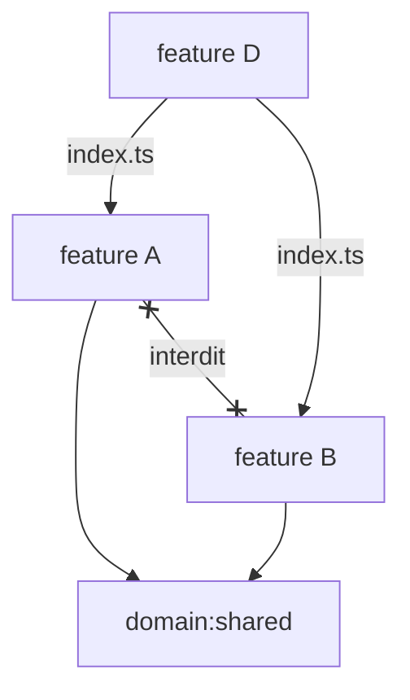
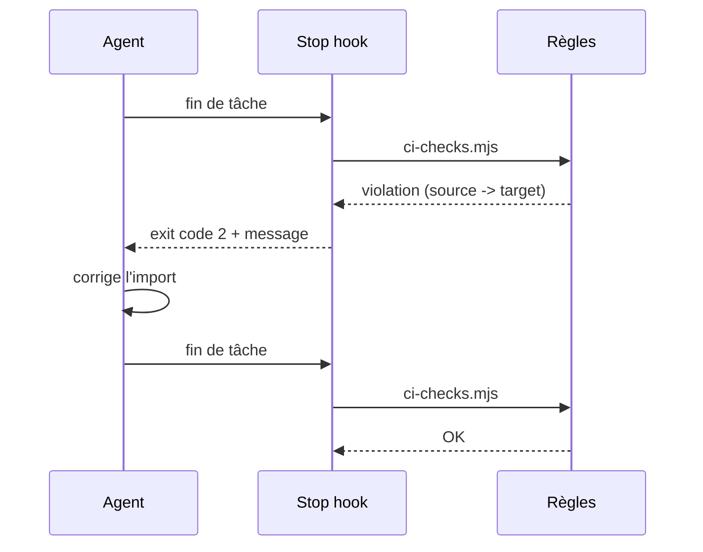

# Renforçons nos règles d'architecture frontend,<br/>pour les humains comme pour les agents 🏗️👮🤖

*Votre architecture n'existe que si elle est exécutable*

---
<a name="1.0"></a>
## Introduction & contexte


### Votre serviteur

- Benjamin Legrand /<!-- .element class="fragment"-->  `@benjilegnard`
- Front-end Architect / Tech Lead / ArchiFrontOps<!-- .element class="fragment"--> 
- onepoint<!-- .element class="fragment"--><span class="sky">.</span>
- Expertise<!-- .element class="fragment"-->  
Notes:
- je passe souvent sur des applis front où l'archi front laisse franchement à désirer
- voir il n'y A PAS d'architecture


### Storytelling

Notes:
- storytelling: une armée d'agents/de juniors se lance dans la réal d'un projet
- features `catalog`, `basket`, `orders`, puis `checkout` qui utilise les trois, et 6 mois plus tard c'est la merde


### Six mois plus tard



Notes:
Exemple mermaid : `checkout` qui utilise `catalog`, `basket` et `orders`, et le spaghetti qui s'installe.


### La thèse
une règle d'architecture non exécutable n'existe pas
Notes:
- souvent vu une architecture = un slide au début du projet => oublié dès le 2e sprint
- big 2026 je trouve que de plus en 
- vos docs d'archis, adr et nfr non-exprimés ne suffisent pas


### Périmètre

Notes:
- périmètre : Front, TypeScript d'abord, exemples Angular, ce qui est transposable à React / Vue, et au back.
- transposable à du backend node.js.
- même si examples très spécifiques angular


> <span class="peach">✻ Gibberblooping...</span> I'll look into the codebase for existing patterns... 

*Claude*


### Architecture?
~~infrastructure~~
Notes:
- je vais parler d'architecture logicielle
- pas de cloud, pas de serveur, pas de briques haut niveau
- on va être au niveau fichiers, répertoire, organisation d'un projet front.
- comment on organise notre code, pourquoi c'est tjrs important
- et comment faire en sorte que nos agents (comme nos devs) respectent l'architecture


---
<a name="2.0"></a>
## Pourquoi on "architecture" le code ?
Notes:
- vu qu'ont devrait arrêter de l'écrire selon certains, est ce qu'on devrait pas arrêter de l'architecturer ?


## Pourquoi on "découpe" le code ?


### Après tout...
je pourrais tout mettre dans un seul fichier app.js...

Notes:
- claude s'en fout
- regardez les artefacts générés par certains vibe-coders, 60mb dans un HTML


### Avoir un vocabulaire commun
💬
Notes:
- pourquoi on fait de l'architecture ? pour avoir un vocabulaire commun
- parler échanger, avoir des mots


### Apparté vocabulaire: angular
- Route<!-- .element class="fragment"-->
- Guard<!-- .element class="fragment"-->
- Resolver<!-- .element class="fragment"-->
- Pipe<!-- .element class="fragment"-->
- Service<!-- .element class="fragment"-->
- Component<!-- .element class="fragment"-->
- Directive<!-- .element class="fragment"-->
Notes:
- une des raisons pour lequels j'adore angular


### Apparté vocabulaire: React
- Component<!-- .element class="fragment"-->
Notes:
- c'est important qu'on ait des mots, qu'on ait des briques de base


### Un tas de briques

Notes:
- en tant que lead ou archi, on file des briques a nos devs


### Expectations

Notes:
- on se dit c'est bon ils vont se démerder
- pas besoin de guidelines d'archi hein


### Reality

Notes:
- la réalité c'est souvent ca plutôt


### Maintenabilité
💸
- le coût du changement
Notes:
- ce qu'on protège vraiment : le coût du changement, pas la beauté du schéma
- même si l'ia, gnagna, couts en tokens


### Rayon d'explosion
💥
- l'impact d'un changement
- combien de fichiers touchés par une modif' "simple"
Notes:
- j'hallucine sur certains projet de la complexité accidentelle
- notre boulot c'est de gérer la complexité, pas d'en rajouter


### Onboarding
Notes:
- onboarding : le temps pour qu'un nouveau (humain ou agent) trouve où écrire son code


### Des boites

Notes:
- on mets des trucs dans des boites, on a des mots, les mots on un sens (apparté: les mots ont un sens/les tokens ont un poids)


### Répondre à la question:<br/>"où mettre mon putain de code ?"

Dev junior quand il faut ajouter un fichier :


Notes:
- junior et senior hein
- on est tous junior quand il s'agit d'arriver sur un nouveau projet en maintenance


### Si on ne découpe pas
- le coût de l'archi : boilerplate, indirection, API publiques, cérémonie
Notes:
- à l'heure de l'IA, ça peut partir en sucette GRAVE


### Code that fits in your head
🧠
Notes:
- nos propres limites cognitves, qui si l'on ne fait pas attention vont détruire la société
- TODO article : fin de société
- ayez de l'empathie


### Quand est-ce qu on peut ne pas faire d'architecture
- POC jetable
- durée de vie ultra courte
- scripts perso
Notes:
- pas sur des projets pro, on est des professionels, on se doit d'avoir un niveau d'exigence

---
<a name="3.0"></a>
## Des antipatterns aux règles
Notes:
- dans cette section je vais présenter plusieurs antipatterns, et comment les remédier


antipattern → pattern → règle
Notes:
- je vais essayer de suivre ça


> Antipattern tu perds ton sang-froid

*James Heautot*


## Nos outils pour remédier
- __Lint:__ Eslint, `Sheriff`
- __Jest/Vitest__, `ts-arch`


> Une règle de lint n'attrappe pas toujours un antipattern d'architecture,
> elle verrouille le pattern
Notes:
- la formule qui cadre la section : la règle n'attrape pas toujours l'antipattern, elle verrouille le pattern

---
<a name="3.1"></a>
### Antipattern #1 :<br/> Le composant qui fait tout


#### Histoire vécue
- fichier `app.ts`
```html
<router-outlet></router-outlet>
```
Notes:
- point d'entrée angular
- dans une appli saine, il y a que le router


#### Histoire vécue (2)
- init de l'auth<!-- .element class="fragment"--> 
- rechargement du panier<!-- .element class="fragment"--> 
- sélections de filiales<!-- .element class="fragment"--> 
- analytics global<!-- .element class="fragment"--> 
- un loader global<!-- .element class="fragment"--> 
Notes:
- lister à l'oral, répétition "dans le app.ts"


#### Histoire vécue (3)
- impersonation<!-- .element class="fragment"--> 
- chargement des adresses utilisateurs<!-- .element class="fragment"--> 
- gestion d'erreurs<!-- .element class="fragment"--> 
- gestion des modales<!-- .element class="fragment"--> 
- gestion des droits<!-- .element class="fragment"--> 


Notes:
- croyez le ou non


#### Histoire vécue (4)
- chaque navigation recharge tout
- performance YOLO


#### Antipattern: pas de SRP
- data access (requêtes HTTP)
- état 
- logique métier
- template
Notes:
dans un composant de + de 1000 lignes
-; intestable, non réutilisable, un agent qui le modifie touche à tout


#### Pattern: - smart / dumb components

- Smart: gère la donnée, les events, interagit avec services
- Dumb: UI, affichage uniquement, entrées/sorties


#### pattern : smart / dumb porté par le nommage
`*-page` orchestre
`*-card` (et les autres composants de présentation) affichent
`*-list` 


#### pattern : le composant éclaté en plusieurs rôles

- ui / model / state / client
Notes:
- devient des répertoires contenant plusieurs


#### Pattern : le nommage comme intention lisible par une machine

- `*-page.ts`
- `*-card.ts`
- `*-store.ts`
- `*-client.ts`
- `*-list.ts`
- `*-item.ts`
Notes:
- suffixer les noms de composants
- pas de la screaming architecture


#### règle : ESLint

`no-restricted-imports`, `HttpClient` interdit hors des fichiers `*-client.ts`
Notes:
- on peut déja faire des trucs pas mal avec eslint natif


#### ESLint : `HttpClient` dans les clients

```js
// eslint.config.js
{
  files: ['**/*.ts'],
  ignores: ['**/*-client.ts'],
  rules: {
    'no-restricted-imports': ['error', {
      paths: [{
        name: '@angular/common/http',
        importNames: ['HttpClient'],
        message: 'HttpClient uniquement dans les fichiers *-client.ts',
      }],
    }],
  },
}
```

Notes:
Règle 3.1 : le data access reste dans les `*-client.ts`.


- règle : ts-arch, les `*-card.ts` ne dépendent ni des `*-client.ts` ni des `*-store.ts`


#### ts-arch : les cards restent dumb

```ts [|6|7-9|10]
import { filesOfProject } from 'tsarch';
import { expect, it } from 'vitest';

it('les cards ne dépendent ni des clients ni des stores', async () => {
  const rule = filesOfProject('tsconfig.arch.json')
    .matchingPattern(String.raw`-card\.ts$`)
    .shouldNot()
    .dependOnFiles()
    .matchingPattern(String.raw`-(client|store)\.ts$`);
  expect(await rule.check()).toEqual([]);
});
```

Notes:
Règle 3.1 : le nommage comme intention lisible par une machine. `check()` renvoie la liste des violations, ce qui marche avec n'importe quel runner (le matcher `toPassAsync()` n'existe que pour Jest).


---
<a name="3.2"></a>
### #2 Le props drilling


#### Antipattern : le props drilling


Notes:
- un `@Input` qui traverse 6 à 15 couches
- ajouter un champ modifie toute la chaîne
- antipattern : un `@Input` qui traverse 6 à 15 couches ; chaque composant intermédiaire connaît une donnée dont il n'a pas besoin, ajouter un champ modifie toute la chaîne
- `[input]` descend, `(output)` remonte
- `shell` et `header` ne font que passer le panier pour la pastille


#### Pattern : introduire un store
- le symptôme d'une gestion d'état absente
- on introduit un `-store.ts` (signal store)
- seul le `-page` injecte le store
Notes:
- pattern : le symptôme d'une gestion d'état absente, on introduit un `-store.ts` (signal store) ; seul le `-page` injecte le store, les composants dumb restent en inputs / outputs
- introduire store / ngrx/signals


### Pattern : BasketStore




#### Règle : ts-arch
- `ui/**` ne dépend pas de `state/**`
Notes:
- elle ne détecte pas le drilling, elle verrouille le pattern qui le rend inutile (première application de la formule)


#### ts-arch : `ui` ne dépend pas de `state`

```ts
it('ui ne dépend pas de state', async () => {
  const rule = filesOfProject('tsconfig.arch.json')
    .inFolder('ui')
    .shouldNot()
    .dependOnFiles()
    .inFolder('state');
  expect(await rule.check()).toEqual([]);
});
```

Notes:
Règle 3.2 : elle ne détecte pas le props drilling, elle verrouille le pattern qui le rend inutile.

---
<a name="3.3"></a>
### #3 Organiser une feature


#### Antipatterns : ranger par technique ou par UI
- le découpage par type technique (`components/`, `services/`, `pipes/`)
- l'arborescence qui recopie l'arbre de composants
- même cause pour les deux : on range par technique ou par UI, pas par domaine
Notes:
- antipattern : l'arborescence qui recopie l'arbre de composants, et casse à chaque refacto d'UI


#### Apparté: LIFT

- Locate: Structure the application so developers can find and open related feature files quickly.<!-- .element class="fragment"--> 
- Identify: Name files descriptively with clear type suffixes (such as hero-list.component.ts or auth.service.ts) so their role is instantly obvious.<!-- .element class="fragment"--> 
- Flat: Keep the folder structure as flat as possible for as long as possible before nesting deep subfolders.<!-- .element class="fragment"--> 
- Try to be DRY: Avoid unnecessary code duplication while keeping abstractions readable and sensible (Don't Repeat Yourself)<!-- .element class="fragment"--> 
Notes:
- Styleguide angular


#### Pattern : d'abord le domaine, ensuite le rôle
```text
src/app
├── basket
│   └── …
├── catalog
│   └── …
└── orders
    ├── client
    ├── feature
    ├── model
    ├── state
    └── ui
```
Notes:
- pattern : d'abord le domaine, ensuite le rôle ; les 4 rôles de 3.1 deviennent des dossiers (`orders/feature`, `orders/ui`, `orders/state`, `orders/client`, `orders/model`)


#### En gros: une RegExp
```js
/^src\/app\/(?<domain>[^/]+)\/(?<type>)\//
```


#### Règle : Sheriff
- tags `domain:orders`
- tags `type:feature|ui|state|client|model`
- `depRules` entre types


#### Règle : `depRules` entre types
- `feature` → `ui`, `state`, `model`
- `ui` → `ui`, `model`
- `state` → `client`, `model` ; `client` → `model`


#### Une feature, cinq rôles


Notes:
Exemple mermaid : les depRules Sheriff entre types (section 3.3).


#### Sheriff : domaines et types

```ts [|6-8|11|12-15]
// sheriff.config.ts
import { sameTag, SheriffConfig } from '@softarc/sheriff-core';

export const config: SheriffConfig = {
  entryFile: './src/main.ts',
  modules: {
    'src/app/<domain>/<type>': ['domain:<domain>', 'type:<type>'],
  },
  depRules: {
    root: 'type:feature',
    'domain:*': [sameTag, 'domain:shared'],
    'type:feature': ['type:ui', 'type:state', 'type:model'],
    'type:ui': ['type:ui', 'type:model'],
    'type:state': ['type:client', 'type:model'],
    'type:client': 'type:model',
  },
};
```

Notes:
Règles 3.3 et 3.4 : les placeholders taguent toute l'arbo d'un coup, `sameTag` interdit les liens entre domaines. Les deep imports sont bloqués par défaut : seul l'`index.ts` d'un module est accessible.

---
<a name="3.3"></a>
### #4 Ne pas mélanger les features
- `checkout` qui utilise `catalog`, `basket` et `orders`
Notes:
- le cœur du storytelling de l'intro : `checkout` qui utilise `catalog`, `basket` et `orders`


#### Antipattern : les deep imports
- `checkout` va piocher `orders/state/internal-helper.ts`


#### Antipattern : les dépendances circulaires
- `catalog` importe `basket` qui importe `catalog`


#### Antipattern : le god bucket
- `shared/` devient le dépotoir de ce qu'on n'a pas su ranger
- `utils.ts`
- et toute l'app en dépend


#### Pattern : API publique de module
- `index.ts` comme seule porte d'entrée
- on choisit ce qu'on n'exporte pas


#### Pattern : le sens des dépendances
- unidirectionnel


#### Pattern : quand `checkout` a besoin de `catalog` et `basket`
- on remonte dans un module partagé typé
- ou on orchestre au niveau de `checkout`
- jamais de lien horizontal `catalog` ↔ `basket`


#### Les features entre elles



Notes:
Exemple mermaid : API publique par index.ts, dépendances unidirectionnelles, jamais de lien horizontal A ↔ B (section 3.4).


#### Pattern : `shared/` sous discipline
- `domain:shared` n'accepte que `ui`, `model` et `util`
- jamais `state` ni `feature`


#### Les barrels
```typescript
// index.ts
export { FeaturePage } from "./feature/feature-page;
```


### Les barrels
- le barrel interne qui ré-exporte tout cache le couplage (antipattern)
- le barrel `index.ts` comme API publique est un contrat (pattern)
Notes:
- slide de clarification sur les barrels : le barrel interne qui ré-exporte tout cache le couplage (antipattern), le barrel `index.ts` comme API publique est un contrat (pattern) ; teaser de la limite ts-arch (section 6)


#### Règle : Sheriff
- encapsulation par `index.ts`
- les deep imports sont bloqués par défaut
- règles `domain:*`


#### Règle : ts-arch
- `shouldBeFreeOfCycles()` (ou `import/no-cycle`) pour les cycles
Notes:
- règles d'import avec eslint sont LENTES


#### ts-arch : pas de cycles

```ts
it('pas de dépendances circulaires', async () => {
  const rule = filesOfProject('tsconfig.arch.json')
    .inFolder('app')
    .should()
    .beFreeOfCycles();
  expect(await rule.check()).toEqual([]);
});
```

Notes:
Règle 3.4 : `catalog` importe `basket` qui importe `catalog`. Alternative côté ESLint : `import/no-cycle`.


#### La règle d'or
> si vous ne savez pas nommer la contrainte, vous ne saurez pas l'outiller
Notes:
- **clôture (1 min)**
- la règle d'or : si vous ne savez pas nommer la contrainte, vous ne saurez pas l'outiller
- transition : "on vient d'écrire 6 règles, laquelle tourne où, et quand ?"


---
<a name="4.0"></a>
## Des règles écrites aux règles exécutables


### Le vrai critère de choix
- ce que l'outil voit (portée)
- puis quand il vous le dit (moment)


### ESLint natif
- angular-eslint, `no-restricted-imports`, `@ngrx/eslint-plugin`
- voit un fichier et ses imports directs
- à la frappe, pre-commit, CI


### Sheriff
- voit le graphe de modules
- à la frappe via son plugin ESLint
- en CLI (`sheriff verify`) en CI
Notes:
- Sheriff : voit le graphe de modules (dossiers avec `index.ts`, tags, `depRules`, encapsulation) ; à la frappe via son plugin ESLint, en CLI (`sheriff verify`) en CI


### ts-arch
- voit les fichiers et leurs conventions dans tout le projet
- y compris à l'intérieur d'un module
- au run de tests uniquement, pas de feedback à la frappe
Notes:
- ts-arch : voit les fichiers et leurs conventions dans tout le projet (nommage, dossiers, cycles), y compris à l'intérieur d'un module ; au run de tests uniquement, pas de feedback à la frappe


### Alternatives
- eslint-plugin-boundaries
- dependency-cruiser
- nx `enforce-module-boundaries`
Notes:
- alternatives : eslint-plugin-boundaries (frontières par chemins, en pur ESLint), dependency-cruiser (graphe complet, CLI, pas d'IDE), nx `enforce-module-boundaries` (si vous êtes déjà en monorepo nx)


### CI
- le filet de sécurité
- jamais la boucle de feedback principale


### Sheriff : dans l'IDE et en CLI

```js
// eslint.config.js
const sheriff = require('@softarc/eslint-plugin-sheriff');

module.exports = tseslint.config({
  files: ['**/*.ts'],
  extends: [sheriff.configs.all],
});
```

```bash
npx sheriff verify   # vérifie les règles
npx sheriff list     # liste les modules et leurs tags
```

Notes:
Même règles, deux boucles de feedback : à la frappe via ESLint, en CI via la CLI.


### La grille de décision
- ce que chaque outil attrape
- ce qu'il rate
- ce que coûte son adoption


### Live (optionnel)
- casser une règle de 3.4 sur le fil rouge
Notes:
- les snippets ont déjà été montrés en section 3 : ici, un seul live (optionnel) qui casse une règle de 3.4 sur le fil rouge


### Le setup réel
- `tsconfig.arch.json`, le runner de tests
- les scripts npm, le job CI


### ts-arch : le setup

```ts
// vitest.arch.config.ts
import { defineConfig } from 'vitest/config';

export default defineConfig({
  test: {
    include: ['arch/**/*.spec.ts'],
    environment: 'node',
    testTimeout: 60_000,
  },
});
```

```json
"test:arch": "vitest run --config vitest.arch.config.ts"
```

Notes:
`tsconfig.arch.json` est une copie du tsconfig principal : ts-arch ne résout pas `extends`.
- à séparer de vos tests u standard

---
<a name="5.0"></a>
## La boucle de feedback des agents


### Pourquoi un agent dérive
- il optimise "du code qui marche"
- pas "du code qui respecte votre architecture"
Notes:
- d'autant plus si vous ne l'avez documenté nulle part


```bash
echo "Make no mistakes" >> AGENTS.md
```


### Les règles comme contexte partagé humains / agents
- `AGENTS.md` pour donner les commandes de vérifications
- hook et CI pour les empêcher
- `.skills/` pour cadrer les compétences / ce que connait l'agent
- `docs/*.md` pour tous
Notes:
- les règles comme contexte partagé humains / agents : `AGENTS.md` pour donner les commandes de vérifications, hook et CI pour les empêcher. 
- `.skills/` pour cadrer les compétences / ce que connait l'agent (partagez-les!).


### Le context layering
- always-on : `AGENTS.md`, `CLAUDE.md`
- task-specific : `docs/architecture-boundaries.md` / skills
Notes:
- éviter de foutre toutes vos règles d'archi dans le contexte commun


### Le stop hook
- un `ci-checks.mjs` commun
- exit code 2 pour Claude Code
- JSON sur stdout pour Cursor
Notes:
- le stop hook : un `ci-checks.mjs` commun, la traduction du résultat par outil (exit code 2 pour Claude Code, JSON sur stdout pour Cursor)


### La boucle de feedback de l'agent



Notes:
Exemple mermaid : le stop hook qui rattrape l'agent (section 5).


### Le stop hook : Claude Code

```js [|4|6-7]
// scripts/hooks/claude-stop-hook.mjs
import { runChecks } from '../ci-checks.mjs';

const result = await runChecks();
if (result.status !== 'success') {
  process.stderr.write(result.message);
  process.exit(2);
}
```

```json
// .claude/settings.json
{ "hooks": { "Stop": [{ "hooks": [{
  "type": "command",
  "command": "node scripts/hooks/claude-stop-hook.mjs",
  "timeout": 600
}] }] } }
```

Notes:
Exit code 2 : Claude Code bloque l'arrêt et renvoie le stderr à l'agent comme feedback.


### Le stop hook : Cursor

```js
// scripts/hooks/cursor-stop-hook.mjs
const input = await readInput();
if (input.status !== 'aborted') {
  const result = await runChecks();
  if (result.status !== 'success') {
    process.stdout.write(JSON.stringify({ followup_message: result.message }));
    process.exit(0);
  }
}
process.stdout.write('{}');
process.exit(0);
```

Notes:
Même cœur `ci-checks.mjs`, autre convention : toujours exit 0, le `followup_message` devient la prochaine tâche de l'agent. `loop_limit: 3` dans `.cursor/hooks.json` borne les tentatives.


### Démo
- l'agent viole une frontière
- le hook le rattrape
- il se corrige tout seul


### Le mode d'échec qui compte
> donnez un test à faire passer à un agent, il finira par modifier le test


### Comment l'agent contourne
- relâcher la contrainte d'archi plutôt que corriger le code
- renommer un fichier pour échapper au pattern de suffixe
Notes:
- relâcher la contrainte d'archi plutôt que corriger le code (les règles de 3.4)
- renommer un fichier pour échapper au pattern de suffixe (les règles de 3.1 et 3.2)


### La parade
- propose-and-confirm
- jamais de relâchement silencieux de règle
- CODEOWNERS, deny en écriture sur les fichiers de règles


### On ne fait que mitiger les problèmes
- mais c'est déjà ça de pris.
Notes:
- vous savez quand est-ce qu'on a pas besoin de ça ? quand on fait de la conception technique en amont.
- et qu'on laisse pas un llm décider de notre architecture


---
<a name="6.0"></a>
## Conclusions, Limites <br/> et "plan du lundi matin"
Notes:
- je fais challenger par claude et il me sort ce concept à chaque fois
- comme si toute conf devait forcément être utilitariste


### Limites
- les suffixes sont une intention, pas une garantie
- les re-exports en barrel masquent les chaînes de dépendances à ts-arch (Sheriff les voit)
- `root: 'type:feature'` : le shell ne peut pas importer les types `model`
- parfois, les messages d'erreur sont laconiques (`source -> target`)
Notes:
- erreurs: ça compte quand le lecteur est un agent
- 


### Les échappatoires
```
// eslint-ignore-file
```
- les échappatoires : comment on déroge, comment une règle évolue, qui valide


### Adopter: plan en 3 étapes
- taguer ses modules et activer les frontières
- n'activer que des 3 règles qui correspondent à une douleur déjà vécue
- brancher le stop hook et la CI


### Adopter: tips & tricks
- éviter de mettre en `error` des règles et partir en week-end
- parlez en entre vous, le top-down ne fonctionne pas
- partagez vos skills / docs & conventions en markdown dans git
Notes:
- exp de tech lead


### Mode suppression d'eslint
// TODO
Notes:
- crééer un fichier avec les violations connues : ne sort pas en erreur, le temps de corriger
- permets d'éviter d'en rajouter sur le nouveau code


### Restez flexibles

Notes:
- on peut pas tout prédire
- y'a rien de pire que de se rendre conte qu'il nous manque une boite


### Conclusion : 

> une règle d'architecture non exécutable n'est pas une règle, c'est un souhait


> le linter est votre meilleur ami, n'en faites pas un ennemi

Notes:
- et on a déjà des outils existants pour cadrer / vérifier ça
- moi ce que je voudrais c'est si vous avez des projets avec eslint, allez regarder ce que ca vérifie déjà, au dela des "recommanded"
- je passe en ce moment sur des projets ou y'a même pas de check CI, ou alors ça a suffisemment fait chier les devs pour qu'ils mettent des eslint-ignore partout
- appropriez-vous vos outils


### Sources des outils (github)
- [eslint/eslint](https://github.com/eslint/eslint)
- [ts-arch/ts-arch](https://github.com/ts-arch/ts-arch)
- [softarc-consulting/sheriff](https://github.com/softarc-consulting/sheriff)
Démo:
- [benjilegnard/beercraft](https://github.com/benjilegnard/beercraft)


### Inspiration


- Manfred Steyer
- <https://www.angulararchitects.io>
- [Reliable Angular Architectures <br/>with AI-Assisted Coding](https://www.angulararchitects.io/en/blog/reliable-angular-architectures-with-ai-assisted-coding/)
- [Architecture Beyond Layers: <br/>tsarch for AI Agents](https://www.angulararchitects.io/en/blog/architecture-beyond-layers-tsarch-for-ai-agents/)


### Merci !

<div style="display:flex;align-items:center;justify-content: space-between;">
    <a
        href="https://github.com/benjilegnard/frontend-architecture-for-humans-and-agents#readme"
        target="_blank"
    >
        
    </a>
    <div>
        ⬅️ Slides & démos 
        <br/><br/><br/>
        Feedback ➡️
    </div>
    <a
        href="https://openfeedback.io/VtrDATVvbl78SyeGnwPs/2026-10-16/cmugz7ijs005r01phz7q0n0c2 "
        target="_blank"
    >
        
    </a>
</div>
